<div align="center">
  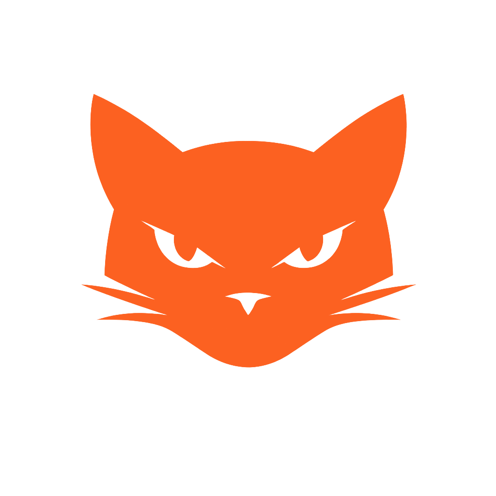
  <h1>Video<font color="#FC6121">CAT</font></h1>
  <p><strong>Catálogo privado para videos repartidos en discos externos, con un Companion para Windows.</strong></p>

  <p>
    <a href="README.md">English</a> · <strong>Español</strong>
  </p>

  <p>
    <a href="https://videocat.centeran.com"></a>
    <a href="https://github.com/reiterstahl/videocat/stargazers"></a>
    <a href="https://github.com/reiterstahl/videocat/releases/latest"></a>
    <a href="https://hub.docker.com/r/reiterstahl/videocat-web"></a>
    <a href="https://github.com/reiterstahl/videocat/actions/workflows/ci.yml"></a>
    <a href="https://github.com/reiterstahl/videocat/releases/latest/download/VideoCAT-Companion-win-Setup.exe"></a>
    <a href="https://github.com/reiterstahl/videocat/blob/main/LICENSE"></a>
    <a href="https://github.com/sponsors/reiterstahl"></a>
  </p>
</div>

VideoCAT indexa los videos de tus discos externos —aunque casi nunca estén conectados— y te deja buscarlos, revisarlos, encontrar duplicados, reproducirlos a distancia y liberar espacio desde el navegador o el móvil. **Los videos nunca salen de tus discos:** el servidor guarda solo metadatos, rutas relativas y miniaturas. También puedes catalogar videos guardados en buckets compatibles con S3 (MinIO, Garage, RustFS, AWS S3, Cloudflare R2…); en ese caso el servidor lee el bucket ([Buckets S3](#5-buckets-s3-opcional)).

> [!TIP]
> ⭐ Si VideoCAT te sirve, [dale una estrella en GitHub](https://github.com/reiterstahl/videocat/stargazers): ayuda a que más gente con colecciones en discos externos lo encuentre.

<p align="center">
  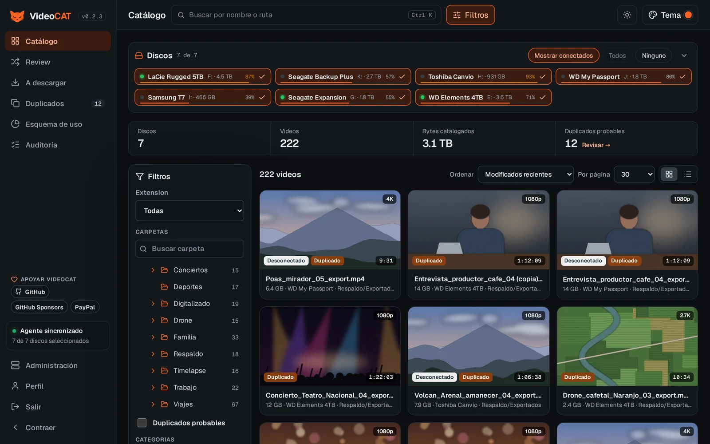
</p>

> [!WARNING]
> VideoCAT puede **borrar archivos físicamente** en Windows: cuando marcas un video para borrar, el Companion lo elimina al conectarse el disco correcto. Antes de usarlo con material importante, lee [Review y borrado seguro](#review-y-borrado-seguro).

## Contenido

- [Cómo funciona](#cómo-funciona)
- [Características](#características)
- [Inicio rápido](#inicio-rápido)
- [Uso diario](#uso-diario)
- [Despliegue en producción](#despliegue-en-producción)
- [Seguridad y privacidad](#seguridad-y-privacidad)
- [Configuración del Companion](#configuración-del-companion)
- [Desarrollo](#desarrollo)
- [Publicar versiones](#publicar-versiones)
- [Documentación relacionada](#documentación-relacionada)
- [Licencia y apoyo](#licencia-y-apoyo)

## Cómo funciona

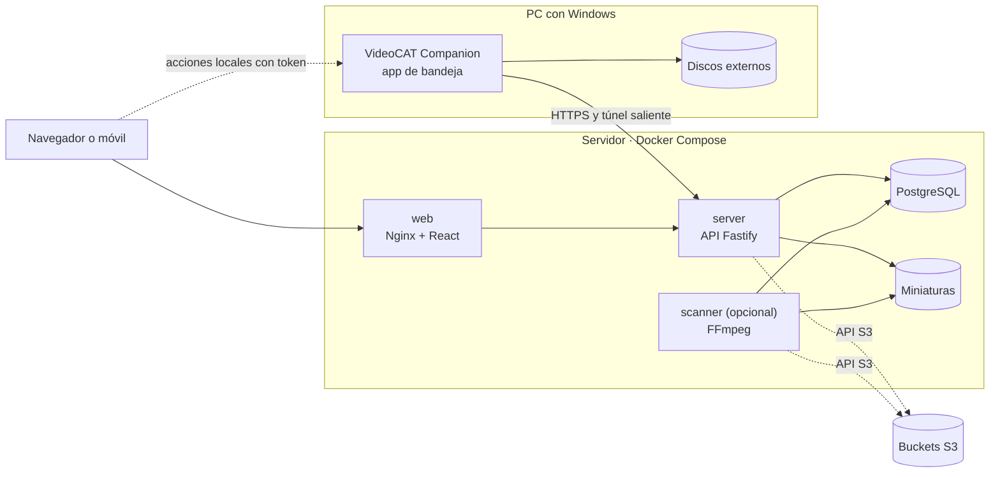

| Pieza | Qué hace |
| --- | --- |
| **web** | Sirve la interfaz React y hace de proxy hacia la API y las miniaturas. Es lo único que publicas en tu reverse proxy. |
| **server** | API con login, catálogo, review, duplicados, auditoría y el túnel con los Companions. Aplica las migraciones al arrancar. |
| **postgres** | Base de datos del catálogo. Solo es accesible en la red interna de Docker. |
| **scanner** | Opcional (`--profile s3`): el código del servidor más FFmpeg. Escanea los buckets S3 y borra sus videos marcados cuando se lo pides. |
| **Companion** | App de bandeja en Windows: detecta discos, escanea con FFmpeg, sube metadatos y miniaturas, procesa borrados y copias, sirve reproducción remota por un túnel **saliente** (no abre puertos) y, si lo activas, lee la salud (SMART) de los discos. |

## Características

### Catálogo
- Cuadrícula o lista, búsqueda con `Ctrl K` tolerante a acentos, chips de filtros activos y panel de detalle; el conteo de resultados muestra el tamaño total de todas las coincidencias.
- Filtros por disco, extensión, carpeta (árbol con carga bajo demanda), etiquetas, categorías y duplicados.
- Tira de discos con capacidad y uso, y **Mostrar conectados** para trabajar solo con lo que está enchufado; los discos conectados aparecen siempre primero.
- Discos identificados por `.videocat-disk.json`: se reconocen aunque Windows cambie la letra de la unidad.
- Miniaturas, galería de 15 fotogramas por video, tamaño de la carpeta y fecha del último indexado.

### Review
- Sesión inmersiva a pantalla completa con videos pendientes al azar, filtrable por discos conectados.
- Atajos de mano izquierda y derecha: **F** mantener, **J** marcar para borrar, más saltar, deshacer y etiquetas numeradas.
- Vista de fotograma o **galería** con todas las miniaturas a la vez.
- Confirmación animada de cada decisión y **modo privacidad** con la barra espaciadora (pantalla en negro). En el móvil, además, el nombre del archivo queda fijo arriba y la vista vuelve sola al inicio.
- Precarga del siguiente video, indicadores de pendientes, racha semanal y espacio marcado para liberar.

### Duplicados
- Detección por tamaño y por **huellas visuales perceptuales** en 15 puntos, que reconocen copias con distinta resolución, códec o compresión.
- Nivel de confianza, motivos y espacio recuperable por grupo.
- Modo asistido con comparación lado a lado, recomendación por resolución, tamaño y duración, y decisiones de un clic o una tecla.
- Priorización de discos por espacio duplicado recuperable.

### Reproducción remota
- Ve cualquier video desde el móvil u otro navegador a través del túnel saliente del Companion, sin compartir rutas de Windows ni montar discos en el servidor.
- Reproductor táctil: doble toque para avanzar o retroceder, siguiente video y modo aleatorio entre discos conectados.
- **Lectura anticipada** ajustable (8 a 128 MB, en Perfil › Reproducción): el servidor pide varios fragmentos a la vez al Companion para que los videos 4K no se queden cargando.
- Remux temporal opcional a MP4 para H.264/AAC en contenedores incompatibles. Chromecast opcional con enlaces firmados y temporales.

### A descargar
- Cola para copiar videos desde discos conectados a una carpeta local de Windows, con progreso por archivo, pausa y vaciado.
- Selección aleatoria por tamaño objetivo en GB, limitada a discos o carpetas, sin repetir lo ya descargado.
- **Detener traslados** desde el encabezado: el archivo en curso termina y no empieza otro hasta que reanudes (las descargas siguen); si reinicias el Companion, vuelven solos.
- **Las descargas van primero.** Si un traslado está copiando cuando pides una descarga, termina ese archivo y se procesa toda la cola de descargas antes de seguir con los traslados; pausar la cola deja que los traslados continúen.

### Traslados
- **Consolidar carpetas**: marca con estrella la carpeta más grande de un grupo repetido (por ejemplo, la "Testing" de 1.7 TB) y lleva ahí el contenido de las demás "Testing", estén en el disco que estén. Antes de empezar se ve el plan: qué sale de cada carpeta, cuánto ocupa y si cabe en el destino.
- **Agrupar archivos**: parte de una carpeta (por ejemplo `testing001`) y busca en todos los discos archivos con un nombre parecido, ignorando mayúsculas, acentos, puntos y separadores, y con una letra de diferencia. Opcionalmente, cada carpeta suma **palabras clave** que se buscan exactas, como palabra completa del nombre (sin importar mayúsculas ni separadores: `GATO`, `.gato.` o `mi_gato_2024` sí; `gatos` o `gatito` no). Se decide uno por uno con la misma sesión de Review: `F` agrupar, `J` ignorar.
- **Mover por etiqueta**: una regla "etiqueta → carpeta con estrella" lleva ahí todos los videos con esa etiqueta, también los que la reciban después, a medida que se conectan sus discos.
- Los discos no necesitan estar conectados a la vez: cada archivo pasa por una **carpeta temporal del Companion**. En **Traslados › Para continuar**, los discos se separan en los que **reciben material** y los que **copian a la carpeta temporal**, con el que más datos debe recibir primero, y se avisa dónde liberar espacio.
- **Nada se borra sin una copia verificada en otro lugar** (detalle en [Traslados seguros](#traslados-seguros)).

### Buckets S3
- Agrega buckets compatibles con S3 (MinIO, Garage, RustFS, AWS S3, Cloudflare R2, Backblaze B2…), o un prefijo dentro de ellos, desde **Administración › Almacenamiento S3**: endpoint, región, bucket, prefijo, access key, secret key y estilo de ruta. **Probar conexión** lista y lee antes de guardar, y explica cada falla (dirección, llave o secret equivocados, permiso que falta, región, estilo de ruta necesario con una IP…).
- Cada bucket es un disco más: catálogo, búsqueda, Review, duplicados y uso por carpeta. El contenedor opcional `scanner` lee los videos nuevos o cambiados por rangos (nunca los descarga enteros), conserva la ficha de un objeto copiado a otra clave y vuelve a escanear cada 24 horas o con **Escanear ahora**.
- Puedes reproducirlos en cualquier navegador o en Chromecast a través del servidor, marcarlos para borrar y procesar los pendientes, y descargarlos a la PC con el Companion (0.2.21 o posterior). Los traslados todavía no incluyen buckets.
- La secret key se guarda cifrada con `STORAGE_SECRET_KEY` y no se vuelve a mostrar.

### Organización, administración y auditoría
- Categorías propias con colores, asignables varias por video, y etiquetas automáticas a partir de los nombres.
- **Esquema de uso** como mapa de carpetas por tamaño, navegable por niveles.
- **Uso por carpeta**: mapa estilo WinDirStat donde las carpetas con el mismo nombre se juntan aunque estén en discos y niveles distintos (por ejemplo, todas las "Testing"). Un clic **entra en la carpeta** y muestra toda su distribución, nivel por nivel, hasta los videos mismos como bloques proporcionales a su tamaño; los nombres genéricos se pueden excluir de la agrupación. Con clic derecho: **ir al catálogo** o marcar la carpeta como **favorita** (sus videos nunca se ofrecen para moverse a otra carpeta). El **espacio libre** de cada disco también aparece en el mapa, siempre del mismo color, para saber siempre cuánto lugar queda. La **búsqueda instantánea** (atajo `/`) deja solo los bloques que coinciden, sin importar mayúsculas ni tildes, y en el último nivel filtra los videos.
- Administración con espacio físico y catalogado por disco, Companions emparejados, actividad reciente y limpieza. Cada disco se puede renombrar (el nombre se guarda también en su marcador), vaciar o, si ya no existe, **eliminar** de VideoCAT, y muestra su **salud (SMART)** y cuántos archivos no dejó leer.
- Auditoría de errores agrupados y acciones, con búsqueda, filtros y exportación CSV.
- Carpetas protegidas por PIN según patrones de nombre, excluidas del cálculo de duplicados.

### Interfaz
- **App instalable (PWA)** en Windows, macOS, Android, iPhone y iPad: se abre desde su propio ícono en una ventana sin pestañas, se actualiza sola con cada versión del servidor y avisa cuando no hay conexión. No guarda datos del catálogo en el dispositivo.
- **Indicador de actividad** en el encabezado: qué está haciendo el Companion en este momento (copiando, verificando, descargando, escaneando o borrando) y un panel con progreso, velocidad, ETA y los últimos movimientos. Arriba muestra cuánto falta con los discos conectados (**faltan x de y por mover**) y, por disco, si **ya puedes desconectarlo** o conviene esperar.
- **Pantalla de inicio de sesión** con una hoja de fotogramas junto al formulario (una franja arriba en el móvil), cambio de idioma y tema, mostrar contraseña y mensajes claros ante una contraseña incorrecta o demasiados intentos. No muestra nada del catálogo antes de entrar.
- Español e inglés, temas claro, oscuro, OLED o del sistema, seis colores de acento y densidad cómoda o compacta.
- Responsive: barra lateral contraíble en escritorio, barra de pestañas y hojas desplegables en el móvil.
- Cada sección tiene su URL (`/catalogo`, `/review`, `/duplicados`…), que también se puede abrir con su equivalente en inglés.

### Companion de Windows
- Se instala con un Setup.exe, sin permisos de administrador, y **se actualiza solo** desde GitHub Releases.
- En español o inglés, según el idioma de Windows o el que elijas en su configuración.
- Emparejamiento con un código de un solo uso y credencial individual cifrada por Windows.
- Monitorea discos con marcador y rutas añadidas a mano, y reescanea periódicamente sin repetir trabajo.
- **Una carpeta renombrada o un archivo movido dentro del mismo disco no se vuelve a procesar**: su ficha del catálogo lo sigue con sus etiquetas, revisión, miniaturas y huella. Una copia queda como un video aparte.
- Un disco renombrado en Administración guarda también el nombre nuevo en su `.videocat-disk.json`.
- Concilia archivos ausentes sin perder etiquetas ni historial, y los reactiva si reaparecen.
- Antes de borrar, revalida tamaño, fecha y huella visual; si la ruta ya contiene otro archivo, cancela.
- Mueve los archivos de los **Traslados** a través de una carpeta temporal local, verificando cada copia con SHA-256.
- Mientras trabaja (copiando, verificando, descargando, escaneando o borrando), el color de acento elegido en la web recorre el borde blanco de su ícono en la bandeja, y al pasar el cursor muestra la tarea, el avance y cuánto falta.
- Un archivo que deja de responder en un escaneo (sectores dañados con el disco conectado) no lo bloquea: una lectura que no responde en 30 s o da un error de lectura no se reintenta, el escaneo sigue y el archivo queda **En riesgo**, sin volver a leerse durante 30 días. Los traslados y los borrados también se rinden ante un disco que deja de responder en vez de esperar. El catálogo filtra esos archivos (**Con problema de lectura**), cada disco dice en Administración cuántos tiene, y **Volver a leerlos** hace que el próximo escaneo los intente de nuevo.
- **Salud de discos (SMART)**, opcional (Companion 0.2.23 o posterior): el Companion lee cada disco conectado con smartctl, que viene incluido, al conectarlo y cada 6 horas. Administración muestra el estado de cada disco (bien, atención, falla probable o sin datos SMART por su adaptador USB) con sus sectores dañados, errores y temperatura en palabras, y una falla probable levanta un aviso en todas las secciones que se puede descartar hasta que el disco empeore. Más en [Discos que fallan](#discos-que-fallan).

<details>
<summary><strong>Más capturas</strong></summary>

| Review | Duplicados en modo asistido |
| --- | --- |
| 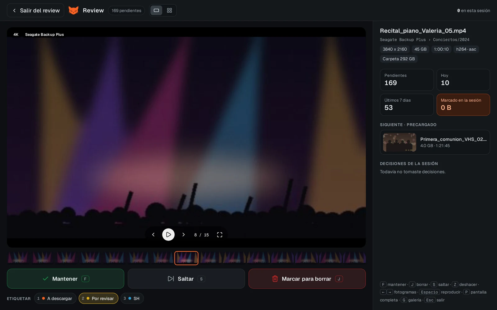 | 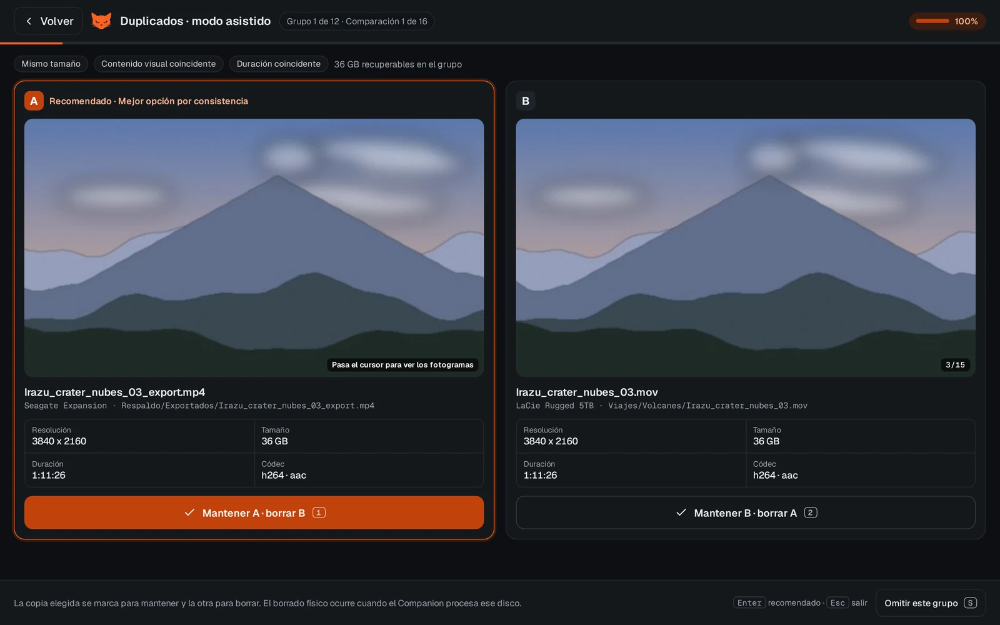 |

| A descargar | Esquema de uso |
| --- | --- |
| 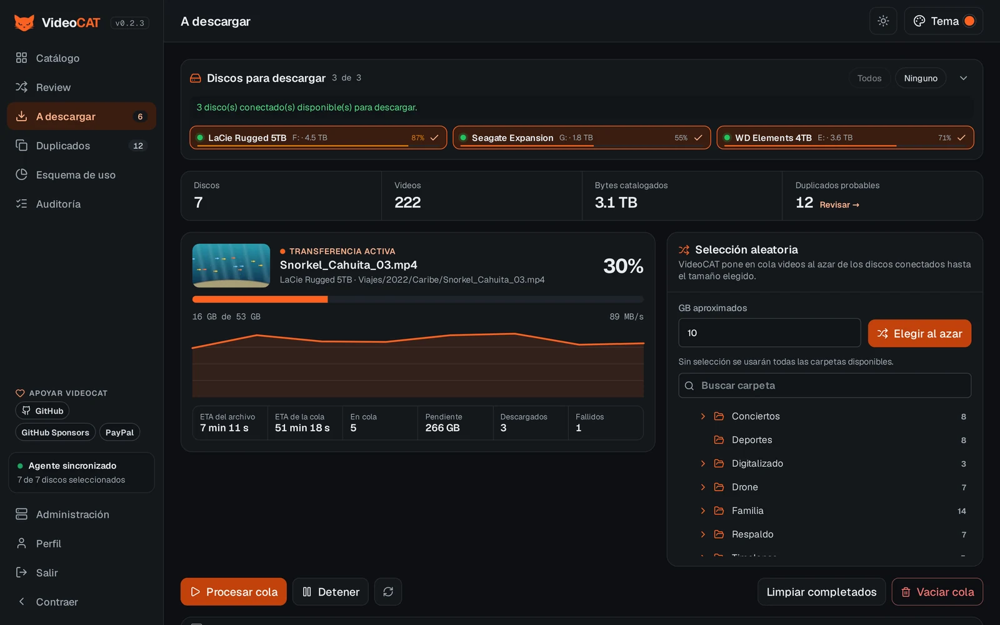 | 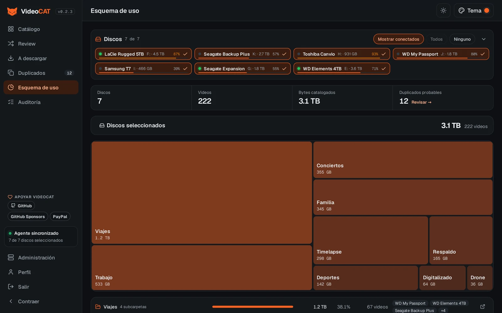 |

| Traslados | Agrupar archivos |
| --- | --- |
| 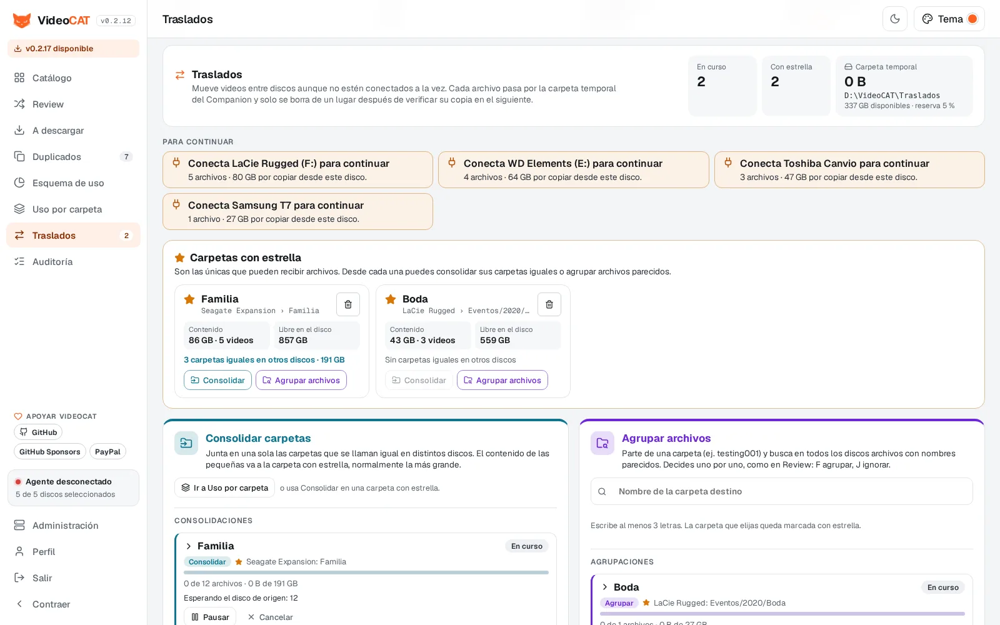 | 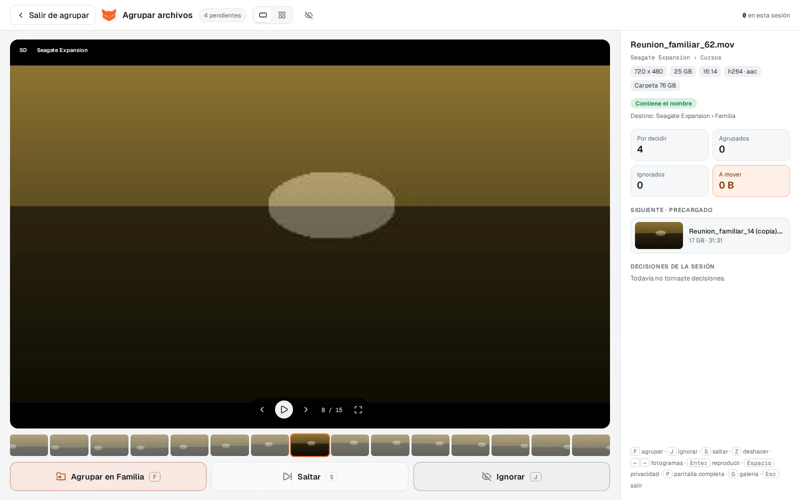 |

| Uso por carpeta con búsqueda instantánea | Actividad con los discos conectados |
| --- | --- |
| 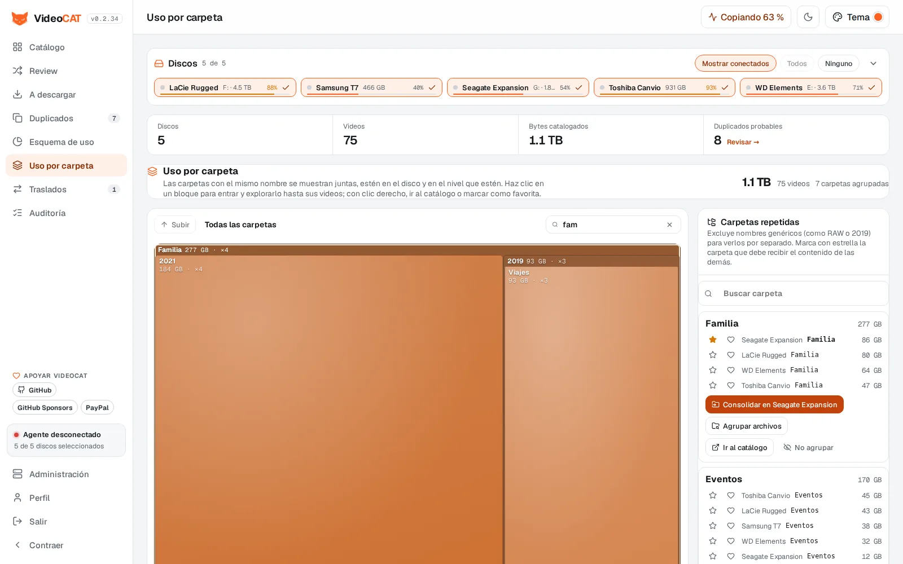 | 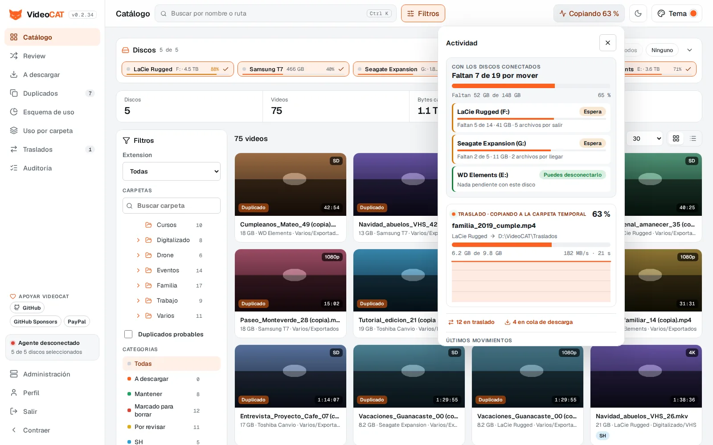 |

| Administración | Companion de Windows |
| --- | --- |
| 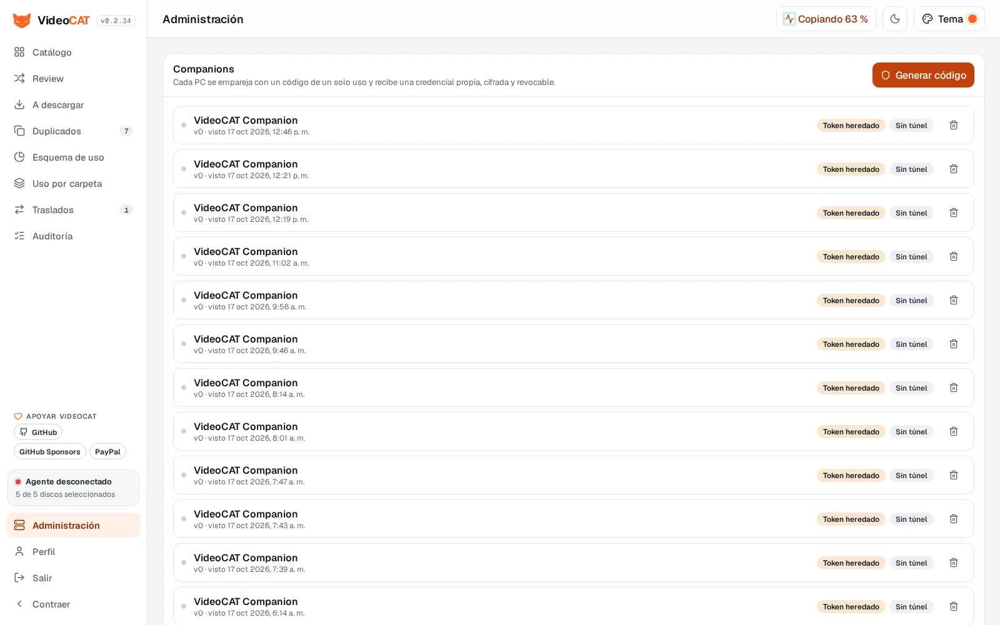 | 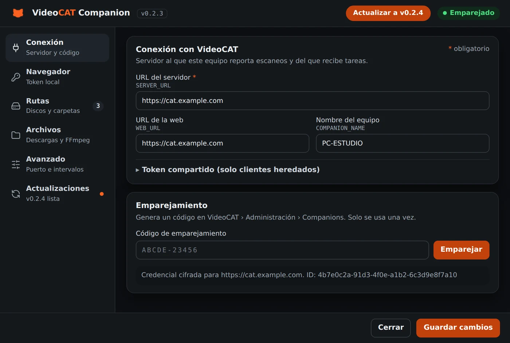 |

| Inicio de sesión · claro | Inicio de sesión · oscuro |
| --- | --- |
| 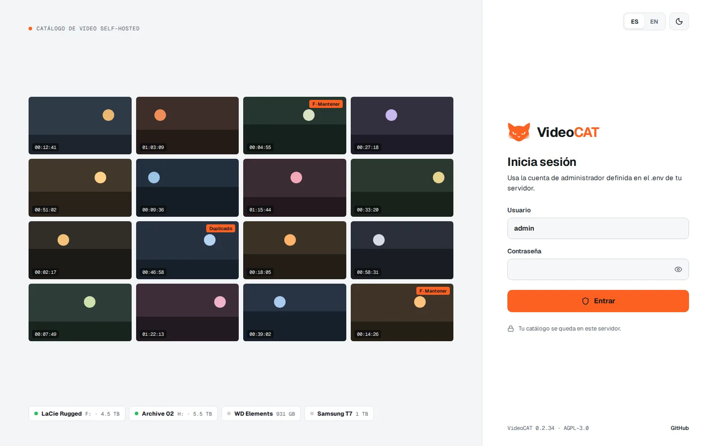 | 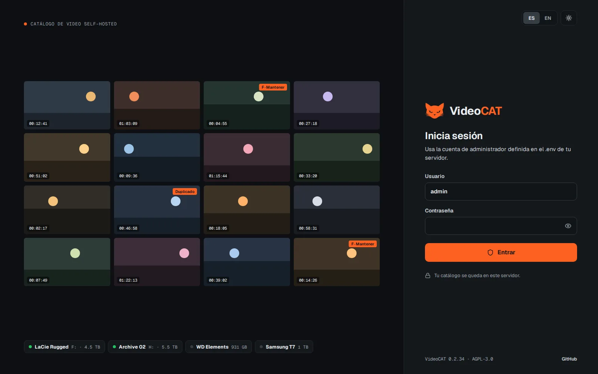 |

<p align="center">
  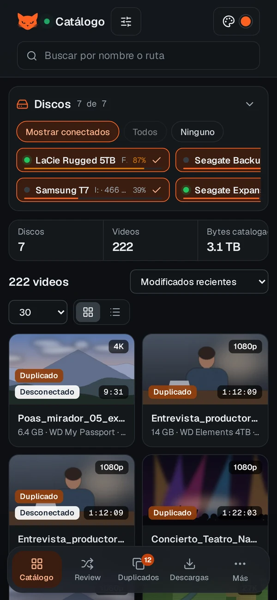
  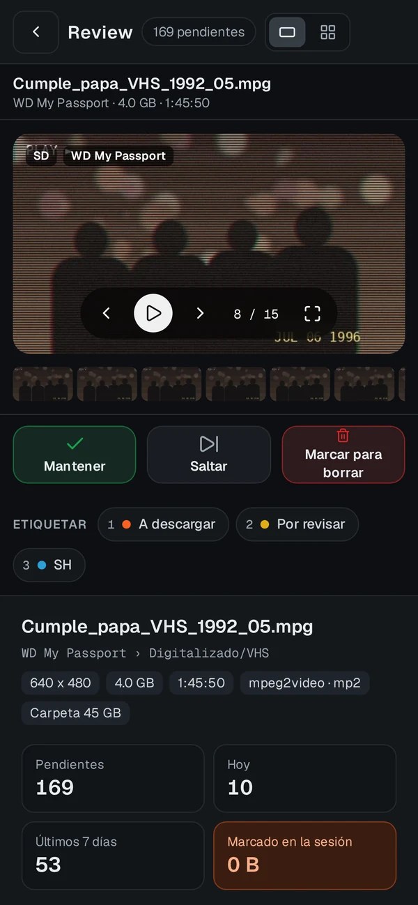
  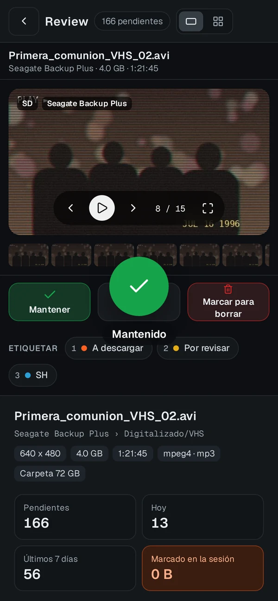
  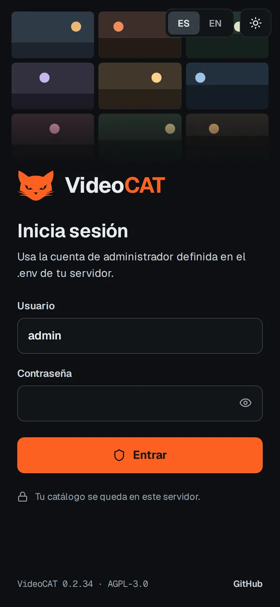
</p>

Todas las capturas usan datos ficticios.
</details>

## Inicio rápido

### 1. Servidor con Docker

Necesitas Docker con Compose. El instalador crea una carpeta `videocat`, descarga `docker-compose.hub.yml`, genera secretos en `.env` y levanta el stack con las imágenes oficiales.

Linux, macOS o WSL:

```bash
curl -fsSL https://raw.githubusercontent.com/reiterstahl/videocat/main/install.sh | sh
```

Windows PowerShell con Docker Desktop:

```powershell
powershell -ExecutionPolicy Bypass -Command "irm https://raw.githubusercontent.com/reiterstahl/videocat/main/install.ps1 | iex"
```

Abre `http://localhost:8081` e inicia sesión como `admin` con la contraseña que muestra el instalador (también queda en `videocat/.env`).

<details>
<summary>Instalación manual con las imágenes de Docker Hub</summary>

```bash
mkdir videocat && cd videocat
curl -fsSLO https://raw.githubusercontent.com/reiterstahl/videocat/main/docker-compose.hub.yml
curl -fsSL https://raw.githubusercontent.com/reiterstahl/videocat/main/.env.example -o .env
```

Edita `.env` y reemplaza todos los valores `replace-with-…`. Genera cada secreto con `openssl rand -hex 32`. Para probar en local sin HTTPS usa `WEB_ORIGIN=http://localhost:8081` y `COOKIE_SECURE=false`. Luego:

```bash
docker compose -f docker-compose.hub.yml up -d
```

Imágenes oficiales (amd64 y arm64): `reiterstahl/videocat-server` y `reiterstahl/videocat-web`, con etiqueta de versión (`0.2.50`) y `latest`.
</details>

### 2. Companion en Windows

1. Instala FFmpeg, que el Companion usa para leer metadatos y generar miniaturas. Lo encuentra solo si lo instalas con WinGet, Scoop o Chocolatey, o en `C:\ffmpeg\bin`:

   ```powershell
   winget install Gyan.FFmpeg
   ```

2. Descarga e instala [**VideoCAT-Companion-win-Setup.exe**](https://github.com/reiterstahl/videocat/releases/latest/download/VideoCAT-Companion-win-Setup.exe) y ábrelo desde el menú Inicio. Queda en la bandeja del sistema.
3. En la web, entra a **Administración › Companions** y genera un código de emparejamiento.
4. En el Companion, abre **Configuración… › Conexión**, escribe la URL del servidor, pega el código y pulsa **Emparejar**.
5. En **Configuración… › Navegador**, copia el token local y pégalo en la web en **Perfil › Companion local**. Así ese navegador puede abrir, copiar y borrar archivos en esta PC.

> [!TIP]
> Si usabas el `.exe` portable (0.2.2 o anterior), ciérralo, instala con Setup.exe y borra el portable: la configuración y el emparejamiento se conservan en `%APPDATA%\VideoCAT Companion`.

### 3. Tus discos

Desde **Configuración… › Rutas** del Companion puedes:

- **Añadir unidad…** y **Convertir…** en una unidad sin marcador: el Companion le escribe su `.videocat-disk.json` con el nombre que elijas y desde ahí la reconoce en cualquier letra.
- **Añadir carpeta…** para una carpeta local o de red.
- Ver los **discos VideoCAT detectados**: los que tienen un archivo `.videocat-disk.json` en la raíz. Ese marcador les da una identidad estable aunque cambie la letra de la unidad, y te deja elegir qué carpetas internas escanear.

> [!IMPORTANT]
> Las unidades añadidas por letra con Companions anteriores a la 0.2.21 muestran **sigue la letra**: Windows puede darle esa letra a otro disco y sus archivos acabarían en el catálogo equivocado. Usa **Fijar identidad…**: el Companion compara una muestra al azar de ese catálogo con los archivos de la unidad que elijas y, si es el mismo disco, escribe el marcador conservando su catálogo. Si la muestra indica otro disco, o un catálogo mezclado con otra unidad, te lo dice y ofrece crear un disco nuevo.

También puedes crear el marcador con el [agente CLI](#agente-cli) (`init-disk` o `wizard`) o a mano en la raíz del disco:

```json
{
  "schemaVersion": 1,
  "diskId": "genera-un-uuid-v4",
  "diskName": "WD 6TB Video 01",
  "createdAt": "2026-10-02T00:00:00.000Z",
  "scanRoots": ["."]
}
```

El primer escaneo sube metadatos y miniaturas. Los siguientes solo procesan lo nuevo o modificado.

### 4. Instalar como app (opcional)

VideoCAT se puede instalar como app desde el navegador. En **Perfil › App de VideoCAT** verás el botón o las instrucciones para tu navegador:

- **Chrome y Edge** (Windows, macOS, Linux, Android): botón **Instalar app** en la barra lateral, o el ícono de instalar en la barra de direcciones.
- **Firefox 143 o posterior en Windows**: ícono **Añadir a la barra de tareas** a la derecha de la barra de direcciones. En Android: menú › **Instalar**.
- **iPhone y iPad**: **Compartir › Agregar a pantalla de inicio**.
- **Safari en macOS**: **Archivo › Añadir al Dock**.

> [!NOTE]
> Los navegadores solo instalan apps desde **HTTPS** (o `localhost`). Si abres VideoCAT por `http://` con una IP de tu red, primero publícalo con HTTPS detrás de tu reverse proxy.

La app guarda en el dispositivo solo su propio código (interfaz, estilos e íconos) para abrir rápido. Las respuestas de la API, las miniaturas y los videos siempre se piden al servidor, así que no queda información del catálogo en el equipo. Cuando publicas una versión nueva del stack, la app muestra **Hay una nueva versión de VideoCAT · Actualizar**.

### 5. Buckets S3 (opcional)

1. Revisa que `.env` tenga `STORAGE_SECRET_KEY` (64 caracteres hexadecimales). Los instaladores la generan desde la 0.2.47; en instalaciones anteriores agrega una creada con `openssl rand -hex 32` y guárdala con tus respaldos.
2. Arranca el escáner: `docker compose -f docker-compose.hub.yml --profile s3 up -d`. En Portainer, agrega la variable `COMPOSE_PROFILES=s3` al stack y vuelve a desplegarlo.
3. En **Administración › Almacenamiento S3**, agrega el bucket y prueba la conexión. El primer escaneo empieza en unos segundos.

Probado con MinIO, Garage y RustFS. Con Garage, la región es el `s3_region` de su configuración (`garage` por defecto), no `us-east-1`; si el endpoint es una dirección IP o `localhost`, deja activado el estilo de ruta.

> [!TIP]
> Dale a VideoCAT una access key solo para ese bucket o prefijo: listar y leer, y borrar solo si vas a borrar desde Review. Más en [Seguridad y privacidad](#seguridad-y-privacidad).

### 6. Salud de discos (opcional)

En el Companion, **Configuración… › Rutas › Salud de discos › Activar…**, y acepta el permiso de administrador de Windows, una sola vez. Un minuto después, **Administración › Discos** muestra la salud de cada disco conectado. Tu cuenta de Windows tiene que poder ser administradora; más en [Discos que fallan](#discos-que-fallan).

## Uso diario

### Review y borrado seguro

1. Entra a **Review** y pulsa **Iniciar Review**. Con **Mostrar conectados**, solo aparecen videos de los discos enchufados.
2. Decide con los botones o con el teclado. Puedes asignar categorías mientras revisas.
3. **Marcar para borrar** no borra nada en el servidor: el video queda en la categoría *Marcado para borrar*.
4. Cuando el disco correcto está conectado y el Companion activo, este borra los archivos pendientes. Antes revalida tamaño, fecha de modificación y huella visual, y resuelve la ruta canónica para no seguir enlaces ni junctions.
5. El historial guarda fecha, disco, ruta y tamaño de cada borrado o fallo, y el contador de espacio liberado se actualiza.

Si prefieres que el Companion no borre solo, cambia **Borrar los marcados** a *Solo a pedido* en **Configuración… › Avanzado**.

| Tecla | Acción en Review |
| --- | --- |
| `F` | Mantener |
| `J` | Marcar para borrar |
| `S` | Saltar |
| `Z` | Deshacer la última decisión |
| `1`–`9` | Activar o quitar una etiqueta |
| `←` `→` | Fotograma anterior o siguiente |
| `Enter` | Reproducir los fotogramas |
| `Espacio` | Modo privacidad: pantalla en negro hasta otro `Espacio`, `Esc` o un clic, sin tomar decisiones |
| `G` | Alternar fotograma y galería |
| `P` | Pantalla completa |
| `Esc` | Salir |

En **Duplicados › Iniciar modo asistido**: `1` o `←` mantiene la copia A y marca la B para borrar, `2` o `→` hace lo contrario, `Enter` aplica la recomendación, `S` salta el grupo y `Esc` sale.

### Traslados seguros

1. Configura en el Companion **Configuración… › Archivos › Carpeta temporal de traslados** (por ejemplo `D:\VideoCAT\Traslados`). Sin ella, los traslados esperan.
2. **Consolidar**: en **Uso por carpeta › Carpetas repetidas**, marca con ⭐ la ubicación que debe recibir los archivos (si hay otra más grande, la interfaz avisa) y pulsa **Consolidar en…**. **Agrupar**: en **Traslados › Agrupar archivos** (o con el ícono de búsqueda del árbol de carpetas del catálogo), elige la carpeta y decide archivo por archivo.
3. Conecta el disco de origen: el Companion copia cada archivo a la carpeta temporal y lo borra del origen **solo después** de verificar la copia.
4. Conecta el disco de destino: el Companion copia desde la carpeta temporal, verifica, actualiza el catálogo y **recién entonces** borra la copia temporal.

Garantías en cada paso:
- La copia se escribe a un nombre provisional, se calcula SHA-256 mientras se copia, se fuerza a disco, se renombra y **se vuelve a leer entera** para compararla. Si no coincide, se descarta y el original queda intacto.
- Antes de borrar del origen se revalida que sea el mismo archivo del último escaneo (tamaño y fecha); si cambió, no se toca.
- Cada paso queda registrado en el servidor antes de avanzar, así que un corte de luz o un disco desconectado a mitad de camino se retoma desde el último paso confirmado.
- Nunca se sobrescribe: si en el destino hay un archivo idéntico, el original queda para revisarlo en Duplicados; si es distinto, el nuevo se guarda como `nombre (2).ext`.
- **Primero salen los archivos de sus discos.** Con varios discos conectados, el Companion pasa antes a la carpeta temporal todo lo que cabe y recién después entrega, así un disco que es origen y destino a la vez libera espacio antes de recibir archivos. Si la carpeta temporal está llena, primero entrega para hacer lugar.
- La unidad de la carpeta temporal siempre conserva libre el **5 %**. La falta de espacio en el destino **no impide crear el traslado**: los archivos salen de su disco y esperan en la carpeta temporal. La web avisa *Faltará espacio en…* según el último escaneo, el Companion vuelve a medir al conectar el destino y entrega cuando hay lugar.
- Mientras viajan, los videos siguen en el catálogo con la marca **En tránsito**. Cancelar solo detiene lo que aún no salió de su disco: lo que ya está en la carpeta temporal termina su camino.

| Tecla | Acción en Agrupar archivos |
| --- | --- |
| `F` | Agrupar en la carpeta |
| `J` | Ignorar (no vuelve a proponerse para esa carpeta) |
| `S` | Saltar |
| `Z` | Deshacer (un archivo agrupado sale del traslado mientras siga pendiente) |

### Discos que fallan

Los discos externos viejos fallan de a poco, y la primera señal suele ser un archivo que tarda una eternidad en leerse. VideoCAT lo vigila de dos formas:

**Archivos con problema de lectura.** Cuando una lectura no responde en 30 segundos, o el disco da un error de lectura, el Companion deja ese archivo enseguida (sin reintentos, que solo estresarían más al disco), sigue con el siguiente y lo marca **En riesgo**: los escaneos siguientes no lo tocan durante 30 días. Un borrado que no puede leer el archivo para confirmar que es el catalogado no lo borra y lo avisa; un traslado cuyo disco deja de entregar datos abandona ese archivo.

1. **Catálogo › Filtros › Con problema de lectura**, o **Administración › Discos › Ver archivos** en el aviso del disco, los muestra.
2. Copia lo que puedas a otro disco con Windows o con una herramienta de recuperación, o revisa el disco con la herramienta de su fabricante. Si ya no necesitas un archivo, bórralo a mano.
3. **Volver a leerlo** en un archivo, o **Volver a leerlos** para todo el disco, los saca de la lista del Companion: el próximo escaneo de ese disco los lee completos. Si vuelven a fallar, regresan a la lista.

**Salud de discos (SMART).** Con la [salud de discos](#6-salud-de-discos-opcional) activa, cada disco dice en Administración:

| Estado | Cuándo |
| --- | --- |
| **Bien** | SMART no reporta nada preocupante. |
| **Atención** | Sectores reasignados o pendientes, reintentos al arrancar el motor, errores de transmisión (casi siempre el cable o el adaptador USB), 55 °C o más, o, en NVMe, errores del medio o 90 % de desgaste. |
| **Falla probable** | SMART dice FAILED, hay sectores o errores de lectura incorregibles, un aviso crítico de NVMe o la reserva de bloques bajo el mínimo, o los sectores dañados aumentaron desde la revisión anterior. Copia lo que no tengas en otro lado. |
| **Sin datos SMART** | El adaptador USB del disco no deja pasar SMART. Los archivos con problema de lectura siguen avisando. |

Una falla probable también muestra un aviso en todas las secciones. **Descartar** lo oculta hasta que el disco empeore.

### Reproducción remota y Chromecast

El reproductor comprueba primero si el navegador soporta el contenedor y los codecs. Para videos H.264 con audio AAC o MP3 dentro de un contenedor incompatible, puedes habilitar un **remux temporal a MP4**, que copia los streams sin recodificar:

1. En el servidor, define `REMOTE_REMUX_ENABLED=true` y reinicia `server`.
2. En el Companion, activa **Remux MP4 temporal** en **Configuración… › Avanzado**.

VideoCAT no transcodifica H.265, AV1 ni otros codecs, porque consumiría mucha CPU. Cada sesión pertenece al usuario que la creó, tiene límites de duración, inactividad y concurrencia, y se cierra al detener el reproductor o perder el túnel.

**Lectura anticipada.** Mientras reproduces, el servidor pide al Companion varios fragmentos a la vez y guarda por delante la cantidad elegida en **Perfil › Reproducción** (8 a 128 MB, 32 MB por defecto), para que un video 4K no se quede *cargando*. Usa esa memoria en el servidor por cada reproducción. Si entras por un dominio público (por ejemplo, detrás de Cloudflare Tunnel), el video sale y vuelve por tu conexión a internet aunque estés en la misma red: la velocidad de subida de esa conexión pone el techo.

Chromecast está desactivado por defecto: actívalo en **Perfil**. El SDK de Google Cast solo se carga al usar el botón, y el receptor recibe una URL firmada y temporal, nunca tus credenciales. El Chromecast debe poder alcanzar el dominio o la IP de VideoCAT.

## Despliegue en producción

### Variables del servidor

Las principales de `.env` (la lista completa, con comentarios, está en [`.env.example`](.env.example)):

| Variable | Para qué sirve |
| --- | --- |
| `POSTGRES_PASSWORD`, `JWT_SECRET`, `AGENT_TOKEN` | Secretos. Genera cada uno con `openssl rand -hex 32`. |
| `ADMIN_USER`, `ADMIN_PASSWORD` | Usuario de la web. |
| `WEB_ORIGIN` | URL pública exacta (por ejemplo `https://cat.example.com`). Las escrituras desde otro origen se rechazan. |
| `COOKIE_SECURE` | `true` con HTTPS; `false` solo para pruebas locales. |
| `TRUST_PROXY`, `TRUST_PROXY_CIDRS` | Confianza en el reverse proxy; mejor limitarla a sus CIDR. |
| `WEB_BIND_ADDR`, `WEB_PUBLISHED_PORT` | Dónde publica el contenedor `web` (por defecto `0.0.0.0:8081`). |
| `PROTECTED_FOLDER_PIN`, `PROTECTED_FOLDER_PATTERNS` | PIN y fragmentos de nombre de carpeta protegidos (por ejemplo `Private,Protected`). |
| `VIDEOCAT_VERSION` | Versión de las imágenes en `docker-compose.hub.yml` (`0.2.50` o `latest`). |
| `REMOTE_REMUX_ENABLED`, `REMOTE_STREAM_*` | Remux opcional y límites de la reproducción remota. |
| `STORAGE_SECRET_KEY` | Cifra las secret keys de los buckets S3 (64 caracteres hexadecimales). Si cambia, hay que volver a escribir la secret key de cada bucket. |
| `S3_SCAN_INTERVAL_HOURS`, `S3_SCAN_CONCURRENCY` | Cada cuánto el escáner vuelve a leer cada bucket (24) y cuántos videos lee a la vez (2). |
| `*_RETENTION_DAYS` | Retención de errores, acciones y escaneos al ejecutar la limpieza desde Administración. |

### Reverse proxy

Publica solo el contenedor `web`: ya hace de proxy de `/api/*` y `/thumbnails/*` hacia `server:4000`, y reenvía el WebSocket del túnel. Tu proxy externo también debe permitir `Upgrade` en `/api/agent/tunnel`. Ejemplo con Nginx:

```nginx
map $http_upgrade $connection_upgrade {
  default upgrade;
  ''      close;
}

server {
  server_name cat.example.com;
  client_max_body_size 25m;

  location / {
    proxy_pass http://127.0.0.1:8081;
    proxy_http_version 1.1;
    proxy_set_header Host $host;
    proxy_set_header X-Real-IP $remote_addr;
    proxy_set_header X-Forwarded-For $proxy_add_x_forwarded_for;
    proxy_set_header X-Forwarded-Host $host;
    proxy_set_header X-Forwarded-Proto $scheme;
    proxy_set_header Upgrade $http_upgrade;
    proxy_set_header Connection $connection_upgrade;
  }
}
```

Con HTTPS, usa `WEB_ORIGIN=https://cat.example.com`, `COOKIE_SECURE=true` y `TRUST_PROXY=true`. HTTPS también es necesario para instalar VideoCAT como app.

### Actualizar

- **Servidor:** fija `VIDEOCAT_VERSION` (o usa `latest`) y ejecuta `docker compose -f docker-compose.hub.yml pull && docker compose -f docker-compose.hub.yml up -d`. Las migraciones se aplican solas al arrancar, y el servicio `thumbnails-init` corrige los permisos del volumen de miniaturas. Desde Portainer: *Pull and redeploy*.
- **Escáner** (solo con buckets S3): llega con el mismo `pull` si el perfil `s3` está activo (`--profile s3`, o `COMPOSE_PROFILES=s3` en Portainer).
- **Companion:** se actualiza solo. Busca versiones nuevas al minuto de arrancar y luego cada 6 horas, las descarga en segundo plano y las aplica al reiniciar. También puedes aplicarlas con **Reiniciar para actualizar** en la bandeja o forzar la búsqueda con **Buscar actualizaciones**.
- La web muestra un aviso junto al logo cuando hay una versión nueva del stack en Docker Hub.

Las notas de cada versión están en [OPERATIONS.md](OPERATIONS.md#upgrade).

### Detrás de Cloudflare Access u otro proxy con login

VideoCAT funciona detrás de un acceso previo como Cloudflare Access. Cuando la sesión de ese acceso caduca, la app muestra **Tu sesión de acceso expiró** con un botón para volver a iniciar sesión y regresar a la misma pantalla. El Companion conviene apuntarlo a la dirección interna del servidor (por ejemplo `http://192.168.1.30:8080`) o darle un *service token*, para que no dependa de ese login.

### Respaldos

`scripts/backup.sh` (o `scripts/backup.ps1`) guarda la base de datos, el volumen de miniaturas, checksums y el `.env`. `scripts/verify-backup.sh` comprueba un respaldo y `scripts/restore.sh` lo restaura. Guarda los respaldos cifrados: contienen rutas y metadatos privados. Detalles y simulacro de restauración en [OPERATIONS.md](OPERATIONS.md).

## Seguridad y privacidad

**Tus datos**
- Los videos originales no salen de tus discos. Se suben metadatos, rutas relativas, miniaturas JPEG validadas y errores de auditoría.
- El servidor no necesita acceso a tus discos. El borrado físico solo ocurre en Windows, por el Companion, con el disco correcto conectado.
- **La excepción: los buckets S3.** Para escanear, reproducir, descargar y borrar sus videos, el servidor y su escáner guardan una llave del bucket (cifrada) y leen su contenido. Los fotogramas se sacan a archivos temporales que se borran enseguida; aparte de las miniaturas, nada de los videos queda en el servidor. Quien tomara el control del servidor podría usar esa llave: dale una limitada a ese bucket o prefijo, con permiso de borrar solo si lo necesitas.
- Las carpetas cuyo nombre coincide con `PROTECTED_FOLDER_PATTERNS` piden PIN en cada sesión y quedan fuera de los duplicados.

**Companion**

- La bandeja (Electron) y el agente (su propio ejecutable, Node SEA) corren sobre un Node.js con las últimas correcciones de seguridad: el empaquetado revisa los dos y rechaza uno anterior. El Companion 0.2.23 y anteriores dejaban la bandeja en un Node sin corregir (24.22.0) mientras Electron no tenía versión con las correcciones de octubre de 2026, y el 0.2.20 y anteriores corrían todo sobre uno (24.19.0): los Companions instalados se actualizan solos al reiniciarse.
- Cada instalación usa una credencial individual, emparejada con un código de un solo uso, cifrada con la protección del usuario de Windows y revocable desde Administración. El servidor guarda solo su hash.
- El túnel es saliente y autenticado, y solo sirve lectura con HTTP Range: no acepta escrituras remotas.
- El listener local solo responde `/health` sin autenticación. Abrir, copiar, borrar y procesar colas exige `COMPANION_TOKEN`.
- Las rutas se resuelven de forma canónica antes de abrir, copiar o borrar, y nunca se sobrescribe un archivo existente al descargar ni al trasladar.
- En los traslados, un archivo solo se borra de un lugar después de verificar con SHA-256 su copia en el siguiente; cada cambio de estado se aplica de forma atómica en el servidor, de modo que una cancelación o dos Companions a la vez no pueden pisarse.
- Las actualizaciones llegan desde GitHub Releases con SHA-256, atestación de origen y SBOM.
- El Companion nunca corre como administrador. La salud de discos, si se activa, pide ese permiso a Windows una vez: smartctl (fijado por SHA-256) y su script se copian a `Program Files\VideoCAT SMART`, donde solo escriben los administradores, y una tarea programada los ejecuta con argumentos fijos; su carpeta de resultados en ProgramData solo la pueden leer los usuarios. Al desactivarla se quitan ambos.

**Web y API**
- Login con JWT de algoritmo fijo que caduca a las 12 horas, y escrituras validadas contra `WEB_ORIGIN`.
- Límites de cuerpo y tiempo, rate limiting, respuestas sensibles sin caché, y CSP y HSTS (bajo HTTPS) en Nginx y Fastify.
- Contenedores sin root, con sistema de archivos de solo lectura y sin capacidades.

**Proyecto**
- En cada cambio a `main` y en cada pull request, CI ejecuta instalación limpia, auditoría de dependencias, typecheck, pruebas unitarias y de API con PostgreSQL, umbrales de cobertura, build y pruebas de interfaz con Playwright en escritorio y móvil.
- Dependabot revisa cada semana las dependencias npm, las imágenes base y las GitHub Actions.

Para reportar una vulnerabilidad de forma privada, consulta [SECURITY.md](SECURITY.md).

## Configuración del Companion

Todo se edita desde **Configuración…**, organizada en páginas: Conexión, Navegador, Rutas, Archivos, Avanzado y Actualizaciones. Se guarda en `%APPDATA%\VideoCAT Companion\.env`. **Salud de discos**, en la página Rutas, se activa y desactiva con su propio botón porque necesita el permiso de administrador de Windows.

<details>
<summary>Variables del Companion</summary>

| Variable | Por defecto | Uso |
| --- | --- | --- |
| `SERVER_URL` | — | URL del servidor VideoCAT (obligatoria). |
| `WEB_URL` | `SERVER_URL` | URL que abre **Abrir VideoCAT**. |
| `COMPANION_NAME` | — | Nombre opcional con el que aparece en Administración. |
| `COMPANION_TOKEN` | Generado | Token de las acciones locales; se pega en Perfil › Companion local. |
| `AGENT_TOKEN` | — | Token compartido, solo para clientes heredados sin emparejar. |
| `COMPANION_DOWNLOAD_DIR` | — | Carpeta destino de **A descargar**. |
| `FFMPEG_PATH`, `FFPROBE_PATH` | Detección automática | Rutas de FFmpeg si no se detectan solas. |
| `AGENT_STATE_DIR` | `%LOCALAPPDATA%\VideoCAT\agent-state` | Estado local de escaneo. |
| `COMPANION_PORT` | `29429` | Puerto local (solo `127.0.0.1`). |
| `COMPANION_ALLOWED_ORIGINS` | — | Orígenes web que pueden llamar al listener local. |
| `COMPANION_AUTO_DELETE_MARKED` | `true` | Borrar los marcados automáticamente o solo a pedido. |
| `COMPANION_REMOTE_REMUX_ENABLED` | `false` | Remux temporal a MP4 para la reproducción remota. |
| `COMPANION_DISK_POLL_MS` | `5000` | Detección de discos. |
| `COMPANION_SCAN_POLL_MS` | `900000` | Reescaneo de rutas monitoreadas. |
| `COMPANION_HEARTBEAT_MS` | `15000` | Latido hacia el servidor. |
| `COMPANION_DELETE_POLL_MS` | `60000` | Revisión de borrados pendientes. |
| `COMPANION_DOWNLOAD_POLL_MS` | `60000` | Revisión de la cola de descargas. |
| `COMPANION_DOWNLOAD_STALL_MS` | `30000` | Tiempo para dar una copia por estancada. |
| `COMPANION_FILE_TIMEOUT_SECONDS` | `180` | Lo máximo que un escaneo dedica a un archivo antes de dejarlo en riesgo (30–3600). Cada lectura sola ya se rinde a los 30 s. |
| `COMPANION_STAGING_DIR` | — | Carpeta temporal de **Traslados**; vacía desactiva los traslados. Siempre deja libre el 5 % de su unidad. |
| `COMPANION_TRANSFER_POLL_MS` | `60000` | Revisión de traslados pendientes (mínimo 15000). |
| `TRAY_DISK_POLL_MS` | `10000` | Refresco de discos en el menú de la bandeja. |
| `COMPANION_LANGUAGE` | `auto` | Idioma de la interfaz y del registro de actividad: `auto` (el de Windows), `es` o `en`. |
| `TRAY_CLICK_ACTION` | `open` | Qué hace el clic o doble clic en el ícono: `open` (abrir VideoCAT), `activity` (mostrar actividad) o `settings` (abrir configuración). |
</details>

### Agente CLI

El mismo agente funciona por línea de comandos desde el repositorio (Node.js 22 o superior, recomendado 24 LTS, con FFmpeg en `PATH`). Usa el mismo `.env`, en `apps\agent-windows\.env`.

```powershell
npm install
npm run wizard -w @videocat/agent-windows                       # asistente interactivo
npm run init-disk -w @videocat/agent-windows -- --path "E:" --disk-name "WD 6TB Video 01" --scan-root "Videos"
npm run add-root -w @videocat/agent-windows -- --path "E:" --scan-root "Archivo/Clientes"
npm run scan -w @videocat/agent-windows -- --path "E:" --disk-name "WD 6TB Video 01"
npm run discover -w @videocat/agent-windows                     # lista discos marcados
```

## Desarrollo

Monorepo TypeScript con npm workspaces (Node.js 22 o superior):

| Carpeta | Contenido |
| --- | --- |
| `apps/server` | API Fastify + Prisma + PostgreSQL, y el escáner de buckets S3 (`src/scanner.ts`). |
| `apps/web` | Interfaz React 18 + Vite, servida por Nginx en producción. |
| `apps/agent-windows` | Agente de escaneo y Companion Electron, con el actualizador Velopack. |
| `packages/shared` | Tipos y utilidades compartidos. |
| `tests`, `e2e` | Pruebas unitarias y de API (`node:test`) y pruebas de interfaz (Playwright). |
| `scripts` | Respaldo, verificación y restauración. |

```bash
npm install
npm run prisma:generate
npm run dev:server   # API en http://localhost:4000 (necesita DATABASE_URL y el resto de variables)
npm run dev:web      # Web en http://localhost:5173
```

Para levantar el stack completo compilando desde el código: `docker compose up -d --build`.

Pruebas:

```bash
npm run typecheck
npm test                          # unitarias, API y umbrales de cobertura
npx playwright install chromium
E2E_SEED=1 npm run test:e2e       # escritorio y móvil
```

Las pruebas de API que escriben en PostgreSQL se activan con `RUN_DB_TESTS=true`. `E2E_SEED=1` carga el catálogo de demostración y **reemplaza todo el contenido de la base**: úsalo solo con una base de desarrollo. Para cargar solo la demo: `VIDEOCAT_DEMO_SEED=1 npm run seed:demo -w @videocat/server` (se niega a correr con `NODE_ENV=production`).

## Publicar versiones

**Companion:** sube `version` en `apps/agent-windows/package.json` y haz push a `main`. El workflow [`release-companion.yml`](.github/workflows/release-companion.yml) compila en Windows, empaqueta con Velopack (Setup.exe, paquete completo y deltas), crea el tag `vX.Y.Z` y publica la release con notas, SHA-256, atestación y SBOM. Una versión que ya tiene tag no se vuelve a publicar. Para relanzarlo a mano: `gh workflow run release-companion.yml -f publish=true`.

**Beta del Companion:** `gh workflow run release-companion.yml -f publish=true -f beta=1` publica `X.Y.Z-beta.1` como prerelease de GitHub. Los Companions instalados no se actualizan a ella: se instala con su Setup.exe y pasa sola a la siguiente versión estable. El empaquetado rechaza un Electron o un agente cuyo Node.js no tenga las últimas correcciones de seguridad.

Build local sin publicar (con `dotnet tool install -g vpk --version 1.2.161` para generar Setup.exe):

```powershell
powershell -ExecutionPolicy Bypass -File .\package-companion.ps1
```

**Imágenes Docker** (amd64 y arm64; actualiza también `VIDEOCAT_VERSION` en `docker-compose.hub.yml` y en los instaladores):

```bash
docker buildx build --pull --no-cache-filter base --platform linux/amd64,linux/arm64 -f apps/server/Dockerfile -t reiterstahl/videocat-server:0.2.50 -t reiterstahl/videocat-server:latest --push .
docker buildx build --pull --no-cache-filter base --platform linux/amd64,linux/arm64 -f apps/server/Dockerfile --target scanner -t reiterstahl/videocat-scanner:0.2.50 -t reiterstahl/videocat-scanner:latest --push .
docker buildx build --pull --no-cache-filter runtime --platform linux/amd64,linux/arm64 -f apps/web/Dockerfile --build-arg VITE_VIDEOCAT_VERSION=0.2.50 -t reiterstahl/videocat-web:0.2.50 -t reiterstahl/videocat-web:latest --push .
```

Verificación del instalador del Companion:

```powershell
Get-FileHash .\VideoCAT-Companion-win-Setup.exe -Algorithm SHA256
gh attestation verify .\VideoCAT-Companion-win-Setup.exe -R reiterstahl/videocat
```

<details>
<summary>Endpoints principales de la API</summary>

Companion (`Authorization: Bearer` con la credencial emparejada):

- `POST /api/agent/register-disk`
- `POST /api/agent/scan/start`, `POST /api/agent/scan/finish`
- `POST /api/agent/files/batch`
- `POST /api/agent/thumbnails/upload`
- `POST /api/agent/errors/batch`
- `GET /api/agent/tunnel` (WebSocket)

Web (sesión):

- `POST /api/auth/login`, `POST /api/auth/logout`
- `GET /api/files`, `GET /api/files/:id`, `GET /api/facets`, `GET /api/disks`
- `GET /api/review/summary`, `GET /api/review/next`, `GET /api/review/recoverable-space`
- `GET /api/duplicates/by-size`, `GET /api/duplicates/recommended-disks`, `POST /api/duplicates/assisted/decision`
- `POST /api/stream-sessions`, `GET /api/stream-sessions/:id`, `DELETE /api/stream-sessions/:id`, `GET /api/playback/random`
- `POST /api/companions/pairing-code`, `GET /api/companions`
- `GET /api/folder-usage`, `GET /api/folder-usage/tree`
- `GET /api/audit/errors`, `GET /api/audit/actions`, `GET /api/audit/export`
- `GET /api/admin/disks/overview`, `GET /api/admin/maintenance`
- `GET /api/profile/security`, `PATCH /api/profile/security`
- `GET /api/version/latest`
</details>

## Documentación relacionada

| Documento | Contenido |
| --- | --- |
| [OPERATIONS.md](OPERATIONS.md) | Actualizaciones, respaldos, restauración y Portainer. |
| [SECURITY.md](SECURITY.md) | Política de seguridad y reporte privado de vulnerabilidades. |
| [apps/agent-windows/TRAY.md](apps/agent-windows/TRAY.md) | Detalle del Companion de bandeja. |
| [ROADMAP.es.md](ROADMAP.es.md) | Plan de endurecimiento y fiabilidad. |
| [REMOTE_STREAMING_PLAN.es.md](REMOTE_STREAMING_PLAN.es.md) | Diseño de la reproducción remota segura. |
| [COMMUNITY_SCRIPTS_PLAN.es.md](COMMUNITY_SCRIPTS_PLAN.es.md) | Plan para publicar VideoCAT en community-scripts (Proxmox VE). |
| [UI_REDESIGN_PLAN.es.md](UI_REDESIGN_PLAN.es.md) | Rediseño de la interfaz por fases. |
| [TRANSFERS_PLAN.es.md](TRANSFERS_PLAN.es.md) | Diseño y avance de Traslados (consolidar y agrupar). |
| [PUBLISHING.md](PUBLISHING.md) | Lista de control para publicar artefactos oficiales. |

## Licencia y apoyo

VideoCAT se distribuye bajo licencia [`AGPL-3.0-or-later`](LICENSE): puedes usar, estudiar, modificar y distribuir el proyecto y sus versiones derivadas, respetando las obligaciones de copyleft y atribución. El Companion de Windows incluye `smartctl.exe` sin modificar de [smartmontools](https://www.smartmontools.org) 7.5 (GPL-2.0-or-later), con su licencia y el enlace a su código fuente al lado.

La distribución oficial incluye enlaces opcionales de apoyo al autor original ([GitHub Sponsors](https://github.com/sponsors/reiterstahl)). Los forks y versiones modificadas pueden quitarlos o reemplazarlos, siempre que cumplan la licencia y conserven los avisos de copyright y atribución.
