<div align="center">
  
  <h1>Video<font color="#FC6121">CAT</font></h1>
  <p><strong>A private catalog for videos spread across external drives, with a Windows Companion.</strong></p>

  <p>
    <strong>English</strong> · <a href="README.es.md">Español</a>
  </p>

  <p>
    <a href="https://videocat.centeran.com"></a>
    <a href="https://github.com/reiterstahl/videocat/stargazers"></a>
    <a href="https://github.com/reiterstahl/videocat/releases/latest"></a>
    <a href="https://hub.docker.com/r/reiterstahl/videocat-web"></a>
    <a href="https://github.com/reiterstahl/videocat/actions/workflows/ci.yml"></a>
    <a href="https://github.com/reiterstahl/videocat/releases/latest/download/VideoCAT-Companion-win-Setup.exe"></a>
    <a href="https://github.com/reiterstahl/videocat/blob/main/LICENSE"></a>
    <a href="https://github.com/sponsors/reiterstahl"></a>
  </p>
</div>

VideoCAT indexes the videos on your external drives — even ones that are rarely plugged in — and lets you search, review, find duplicates, play remotely and free up space from a browser or your phone. **Your videos never leave your drives:** the server only stores metadata, relative paths and thumbnails. Videos kept in S3-compatible buckets (MinIO, Garage, RustFS, AWS S3, Cloudflare R2…) can be catalogued too; for those, the server itself reads the bucket ([S3 buckets](#5-s3-buckets-optional)).

> [!TIP]
> ⭐ If VideoCAT is useful to you, [star it on GitHub](https://github.com/reiterstahl/videocat/stargazers): it helps more people with collections on external drives find it.

<p align="center">
  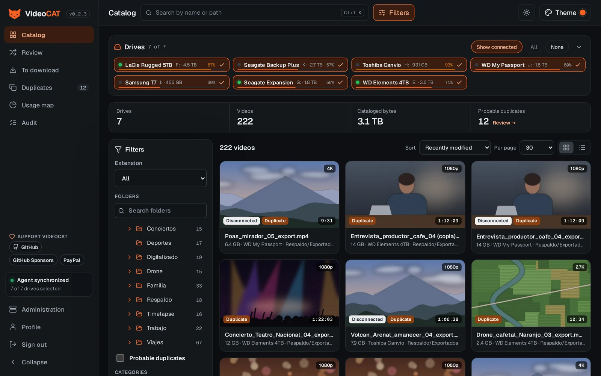
</p>

> [!WARNING]
> VideoCAT can **physically delete files** on Windows: when you mark a video for deletion, the Companion removes it once the right drive is connected. Before using it with important footage, read [Review and safe deletion](#review-and-safe-deletion).

## Contents

- [How it works](#how-it-works)
- [Features](#features)
- [Quick start](#quick-start)
- [Everyday use](#everyday-use)
- [Production deployment](#production-deployment)
- [Security and privacy](#security-and-privacy)
- [Companion configuration](#companion-configuration)
- [Development](#development)
- [Publishing releases](#publishing-releases)
- [Related documentation](#related-documentation)
- [License and support](#license-and-support)

## How it works

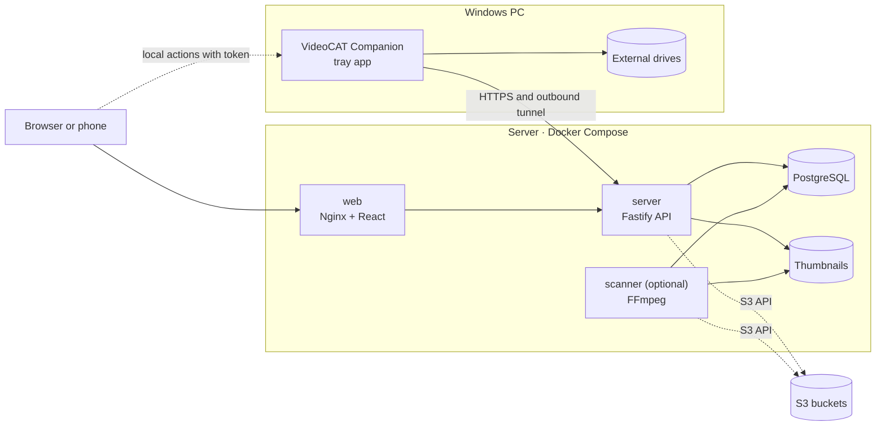

| Piece | What it does |
| --- | --- |
| **web** | Serves the React app and proxies the API and thumbnails. It is the only thing you expose through your reverse proxy. |
| **server** | API for login, catalog, review, duplicates, audit and the Companion tunnel. Applies database migrations on start. |
| **postgres** | Catalog database, reachable only on the internal Docker network. |
| **scanner** | Optional (`--profile s3`): the server's code plus FFmpeg. Scans S3 buckets and deletes their marked videos on request. |
| **Companion** | Windows tray app: detects drives, scans with FFmpeg, uploads metadata and thumbnails, processes deletions and copies, serves remote playback through an **outbound** tunnel (no open ports) and, optionally, reads the drives' health (SMART). |

## Features

### Catalog
- Grid or list view, accent-insensitive search with `Ctrl K`, active filter chips and a detail panel; the result count shows the total size of every match.
- Filters by drive, extension, folder (lazy-loaded tree), tags, categories and duplicates.
- Drive strip with capacity and usage, plus **Show connected** to work only with what is plugged in; connected drives are always listed first.
- Drives are identified by `.videocat-disk.json`, so they are recognized even when Windows changes the drive letter.
- Thumbnails, a 15-frame gallery per video, folder size and last indexed date.

### Review
- Immersive full-screen session with random pending videos, optionally limited to connected drives.
- Left- and right-hand shortcuts: **F** keeps, **J** marks for deletion, plus skip, undo and numbered tags.
- Single-frame view or a **gallery** with every thumbnail at once.
- An animated confirmation for each decision and a **privacy mode** on the space bar (black screen). On phones, the file name also stays pinned at the top and the view jumps back to the top.
- The next video is preloaded; counters show pending videos, the weekly streak and space marked to free.

### Duplicates
- Detection by size and by **perceptual visual fingerprints** taken at 15 points, which match copies with a different resolution, codec or compression.
- Confidence level, reasons and recoverable space per group.
- Assisted mode with side-by-side comparison, a recommendation based on resolution, size and duration, and one-click or one-key decisions.
- Drives ranked by recoverable duplicate space.

### Remote playback
- Watch any video from your phone or another browser through the Companion's outbound tunnel, without sharing Windows paths or mounting drives on the server.
- Touch-friendly player: double-tap to seek, next video and shuffle across connected drives.
- Adjustable **read-ahead** (8 to 128 MB, in Profile › Playback): the server asks the Companion for several chunks at once so 4K videos do not keep loading.
- Optional temporary MP4 remux for H.264/AAC in unsupported containers. Optional Chromecast with signed, short-lived links.

### To download
- A queue that copies videos from connected drives to a local Windows folder, with per-file progress, pause and clear.
- Random selection by target size in GB, limited to drives or folders, without repeating what was already downloaded.
- **Stop transfers** from the header: the file in progress finishes and no other starts until you resume (downloads go on); restarting the Companion resumes them on its own.
- **Downloads come first.** If a transfer is copying when a download is requested, it finishes that file and the whole download queue runs before transfers go on; pausing the queue lets transfers continue.

### Transfers
- **Consolidate folders**: star the largest folder of a repeated group (for example the 1.7 TB "Testing") and move the contents of every other "Testing" into it, whatever drive they are on. Before anything starts you see the plan: what leaves each folder, how much it takes and whether it fits at the destination.
- **Group files**: start from a folder (for example `testing001`) and find files with a similar name on every drive, ignoring case, accents, dots and separators, plus one letter of difference. Optionally, each folder adds **keywords** that are searched exactly, as whole words of the name (ignoring case and separators: `GATO`, `.gato.` or `mi_gato_2024` match; `gatos` or `gatito` do not). You decide one by one in the same Review session: `F` group, `J` ignore.
- **Move by tag**: a "tag → starred folder" rule takes every video with that tag there, including the ones tagged later, as their drives get connected.
- The drives never need to be connected at the same time: each file goes through a **Companion staging folder**. In **Transfers › To continue**, drives are split into those that **receive files** and those that **copy to the staging folder**, with the one that has the most data to receive first, and you are told where to free space.
- **Nothing is removed without a verified copy somewhere else** (details in [Safe transfers](#safe-transfers)).

### S3 buckets
- Add S3-compatible buckets (MinIO, Garage, RustFS, AWS S3, Cloudflare R2, Backblaze B2…), or a prefix inside them, from **Administration › S3 storage**: endpoint, region, bucket, prefix, access key, secret key and path-style addressing. **Test connection** lists and reads before saving, and explains each failure (wrong address, key or secret, missing permission, region, path-style needed for an IP…).
- Each bucket becomes one more drive: catalog, search, Review, duplicates and folder usage. The optional `scanner` container reads new or changed videos by ranges (never downloading them whole), keeps the entry of an object copied to another key, and rescans every 24 hours or with **Scan now**.
- Play them from any browser or Chromecast through the server, mark them for deletion and process the pending ones, and download them to the PC with the Companion (0.2.21 or later). Transfers do not include buckets yet.
- The secret key is stored encrypted with `STORAGE_SECRET_KEY` and never shown again.

### Organization, administration and audit
- Custom colored categories, several per video, and automatic tags from file names.
- **Usage map**: a folder map by size you can drill into.
- **Folder usage**: a WinDirStat-style map where folders with the same name are merged even on different drives and levels (every "Testing", for example). One click **enters the folder** and shows its whole distribution, level by level, down to the videos themselves as blocks sized by file size; generic names can be excluded from merging. A right click goes **to the catalog** or marks the folder as a **favorite** (its videos are never offered to move to another folder). Each drive's **free space** is on the map too, always in the same color, so the room left is always in view. **Instant search** (shortcut `/`) keeps only the matching blocks, ignoring case and accents, and filters the videos at the last level.
- Administration with physical and cataloged space per drive, paired Companions, recent activity and cleanup. Each drive can be renamed (the name also goes into its marker), emptied or, when it no longer exists, **removed** from VideoCAT, and shows its **health (SMART)** and how many files it would not let VideoCAT read.
- Audit of grouped errors and actions, with search, filters and CSV export.
- PIN-protected folders matched by name patterns, excluded from duplicate detection.

### Interface
- **Installable app (PWA)** on Windows, macOS, Android, iPhone and iPad: it opens from its own icon in a window without tabs, updates itself with every server version and tells you when you are offline. It stores no catalog data on the device.
- **Activity indicator** in the header: what the Companion is doing right now (copying, verifying, downloading, scanning or deleting) and a panel with progress, speed, ETA and the latest movements. At the top it shows what is left with the connected drives (**x of y left to move**) and, per drive, whether it is **safe to disconnect** or worth waiting.
- A **sign-in screen** with a contact sheet of frames beside the form (a strip on top on phones), language and theme switches, show password and clear messages for a wrong password or too many attempts. Nothing from the catalog is shown before signing in.
- Spanish and English, light, dark, OLED or system themes, six accent colors and comfortable or compact density.
- Responsive: collapsible sidebar on desktop, tab bar and bottom sheets on phones.
- Every section has its own URL (`/catalogo`, `/review`, `/duplicados`…), also reachable through its English equivalent.

### Windows Companion
- Installs with a Setup.exe, without administrator rights, and **updates itself** from GitHub Releases.
- In Spanish or English, following Windows' display language or the one chosen in its settings.
- Pairs with a one-time code and keeps an individual credential encrypted by Windows.
- Monitors marked drives and manually added paths, and rescans periodically without repeating work.
- **A renamed folder or a file moved on the same drive is not processed again**: its catalog entry follows it with its tags, review, thumbnails and fingerprint. A copy stays a separate video.
- A drive renamed in Administration also gets the new name in its `.videocat-disk.json`.
- Reconciles missing files without losing tags or history, and reactivates them if they come back.
- Before deleting, it revalidates size, modification time and visual fingerprint; if the path now holds a different file, it cancels.
- Moves **Transfers** through a local staging folder, verifying every copy with SHA-256.
- While it works (copying, verifying, downloading, scanning or deleting), the accent chosen in the web travels around the white outline of its tray icon, and hovering it shows the task, how far it got and about how long is left.
- A file that stops answering during a scan (bad sectors on a connected drive) does not block it: a read that gets no answer in 30 s or fails with an I/O error is not retried, the scan moves on and the file is marked **At risk**, left alone by later scans for 30 days. Transfers and deletions also give up on a drive that stops answering instead of waiting. The catalog filters these files (**With read problems**), each drive in Administration says how many it has, and **Read them again** has the next scan try them.
- **Drive health (SMART)**, optional (Companion 0.2.23 or later): the Companion reads each connected drive with smartctl, included, when it connects and every 6 hours. Administration shows each drive's state (good, attention, probable failure or no SMART data through its USB adapter) with its damaged sectors, errors and temperature in words, and a probable failure raises a notice on every section that can be dismissed until the drive gets worse. See [Failing drives](#failing-drives).

<details>
<summary><strong>More screenshots</strong></summary>

| Review | Assisted duplicates |
| --- | --- |
| 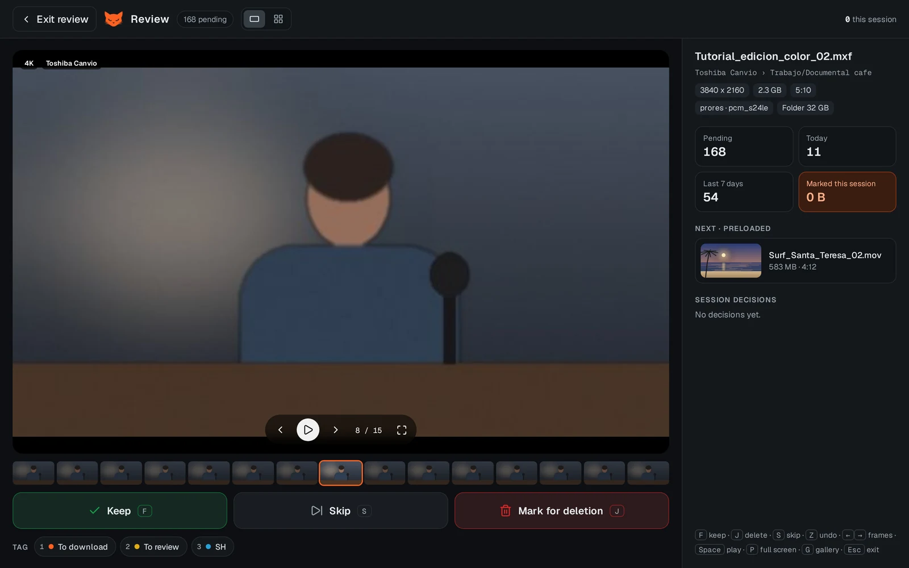 | 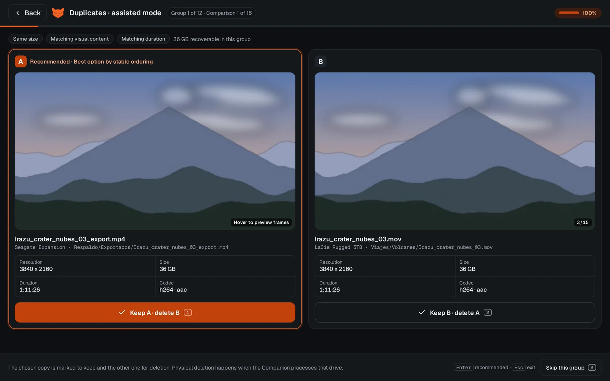 |

| To download | Usage map |
| --- | --- |
| 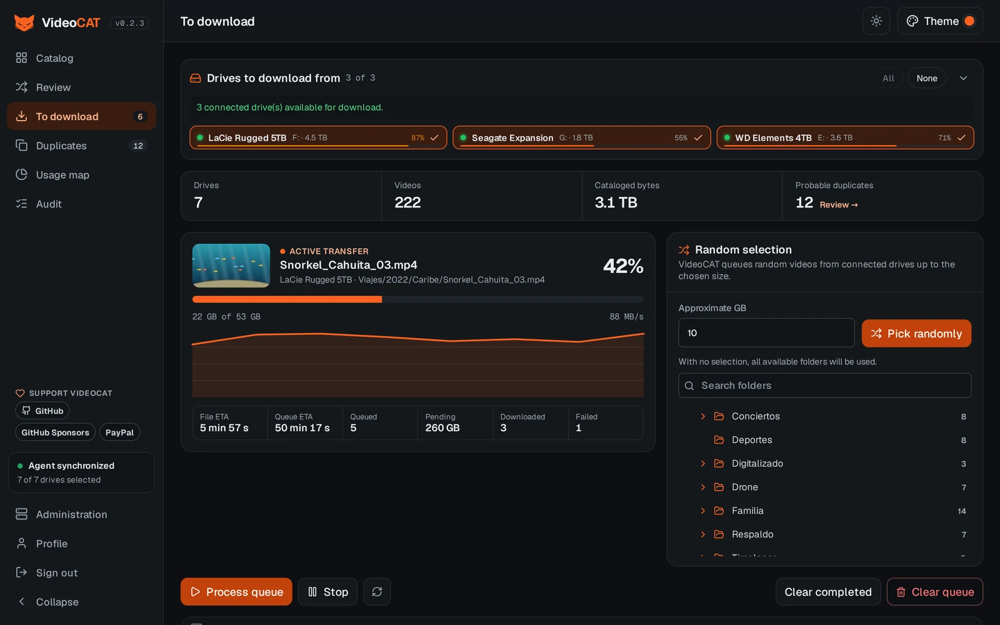 | 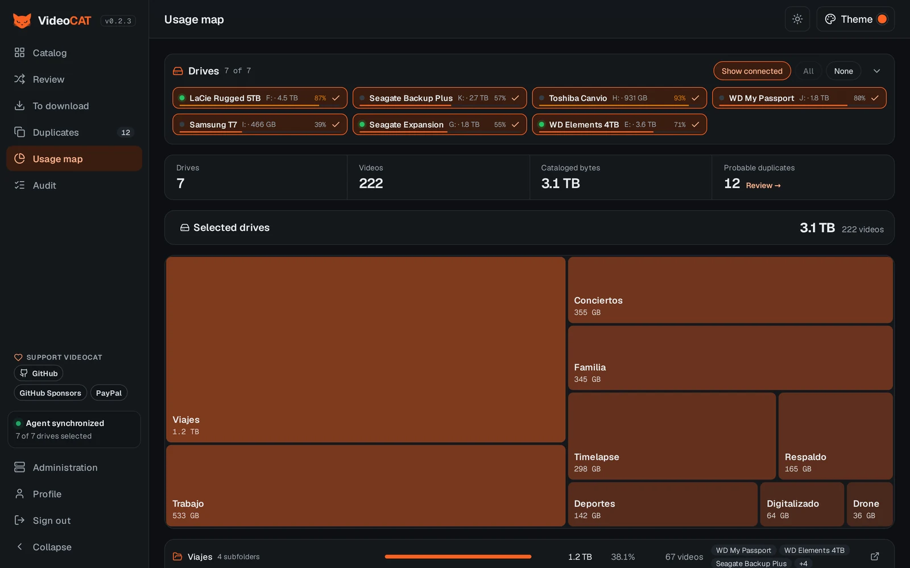 |

| Transfers | Group files |
| --- | --- |
| 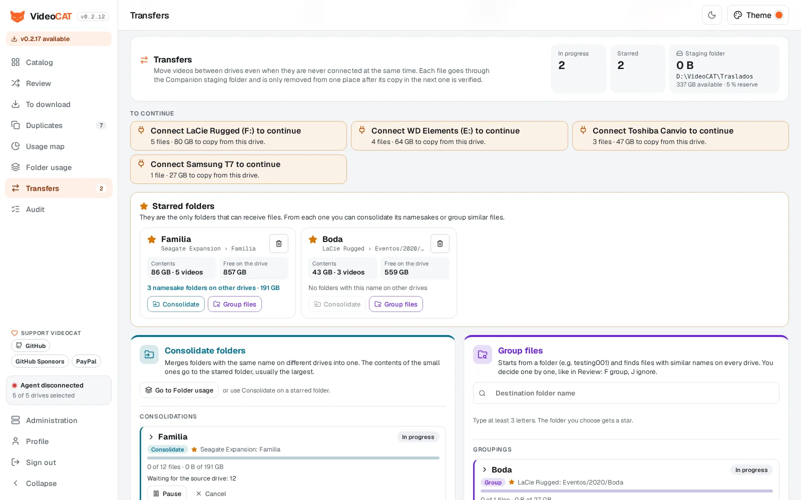 | 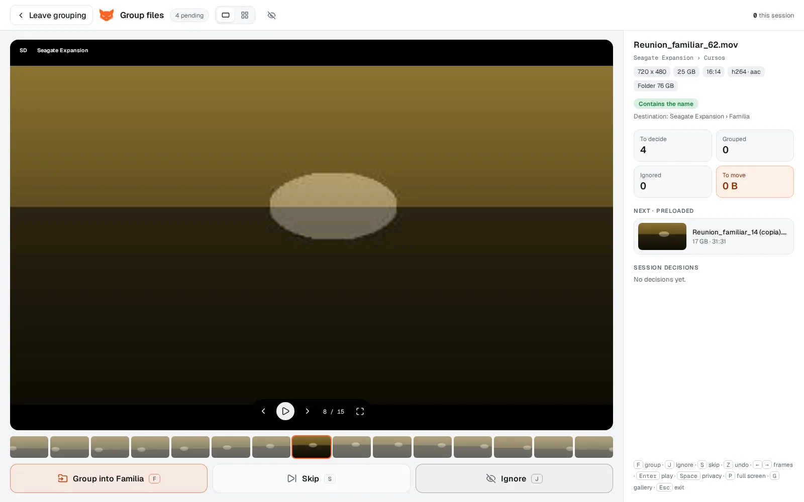 |

| Folder usage with instant search | Activity with the connected drives |
| --- | --- |
| 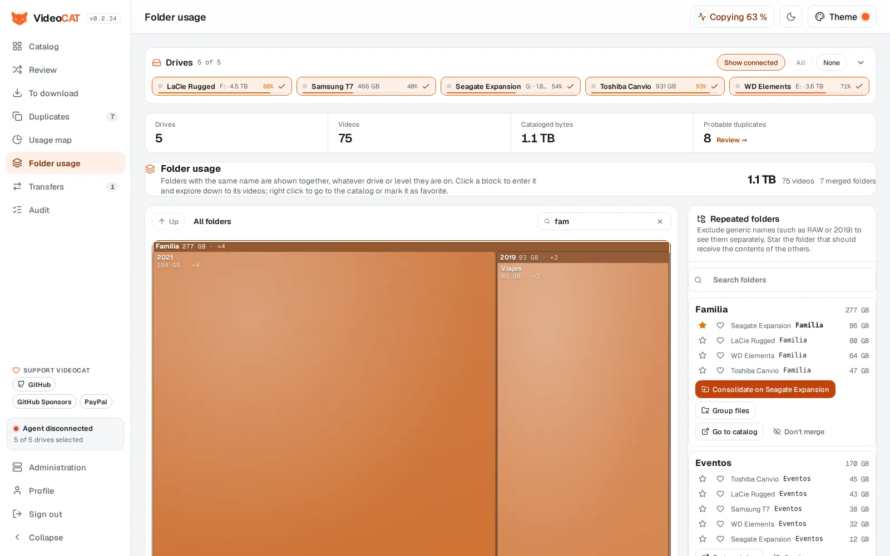 | 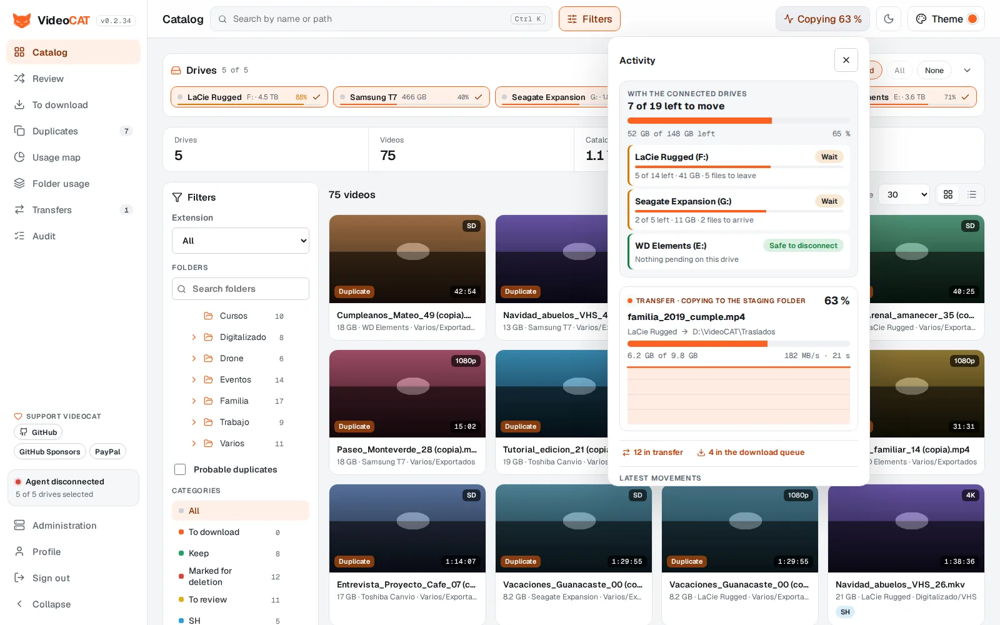 |

| Administration | Windows Companion |
| --- | --- |
| 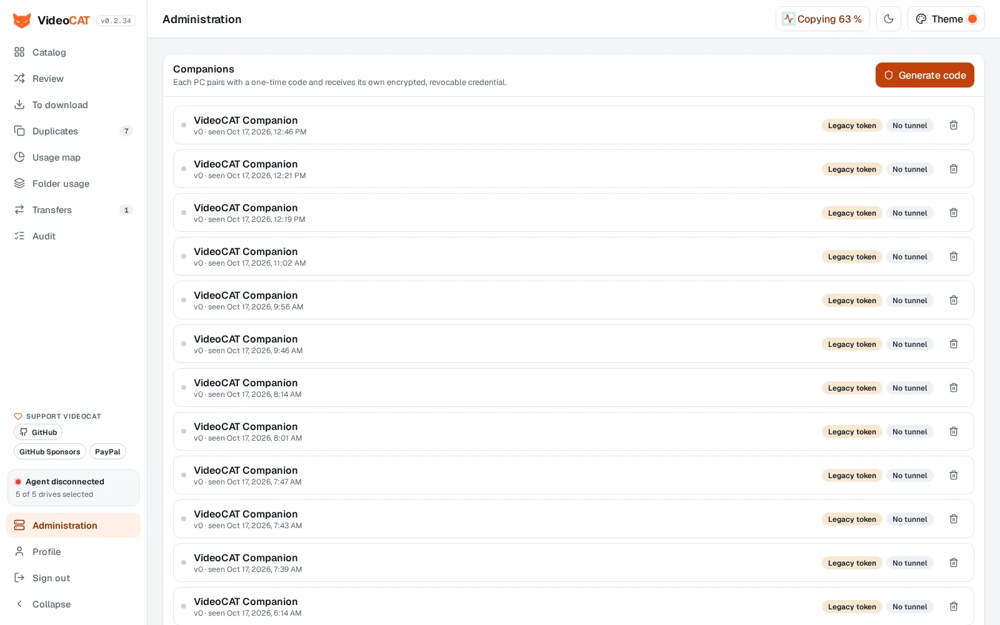 |  |

| Sign in · light | Sign in · dark |
| --- | --- |
| 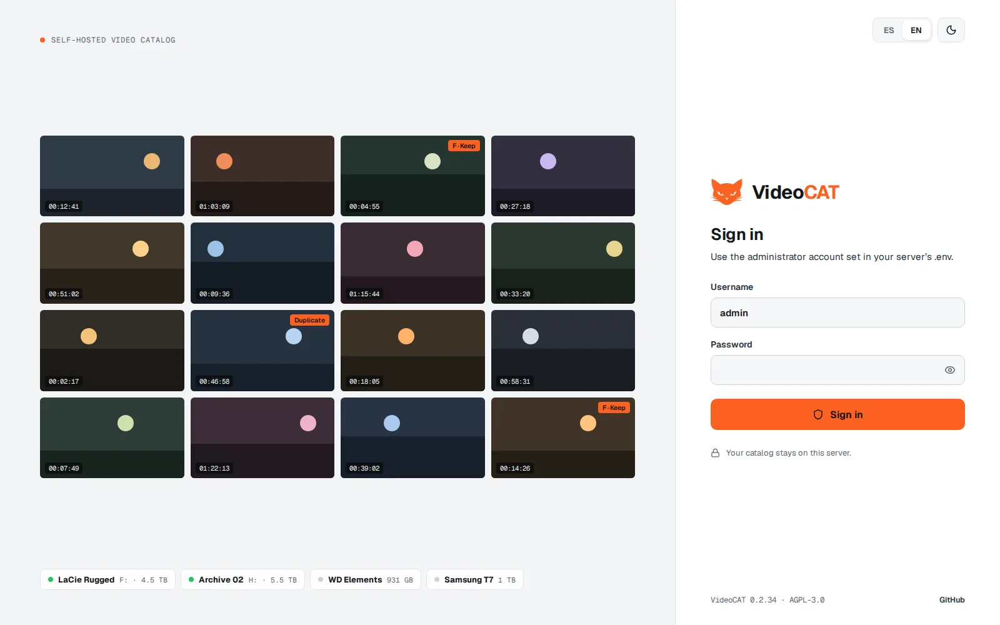 | 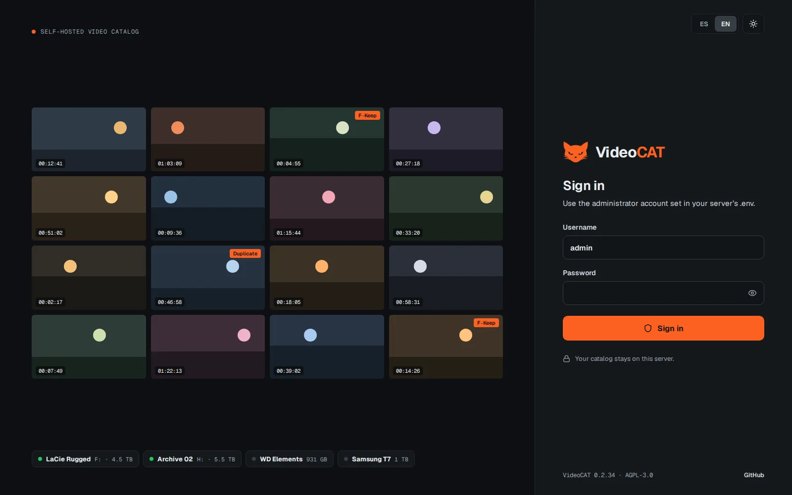 |

<p align="center">
  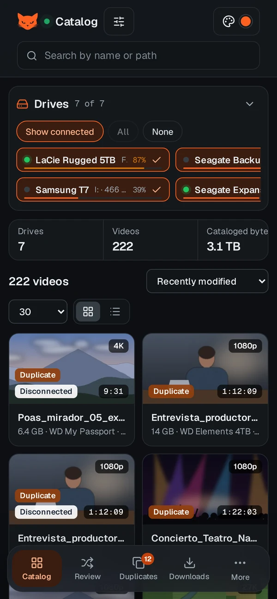
  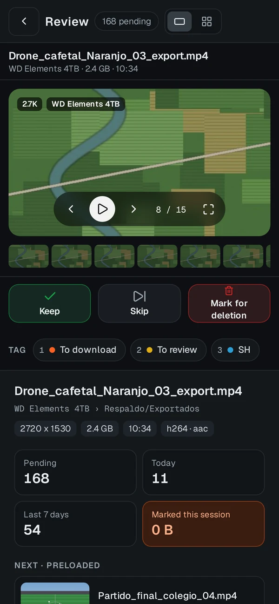
  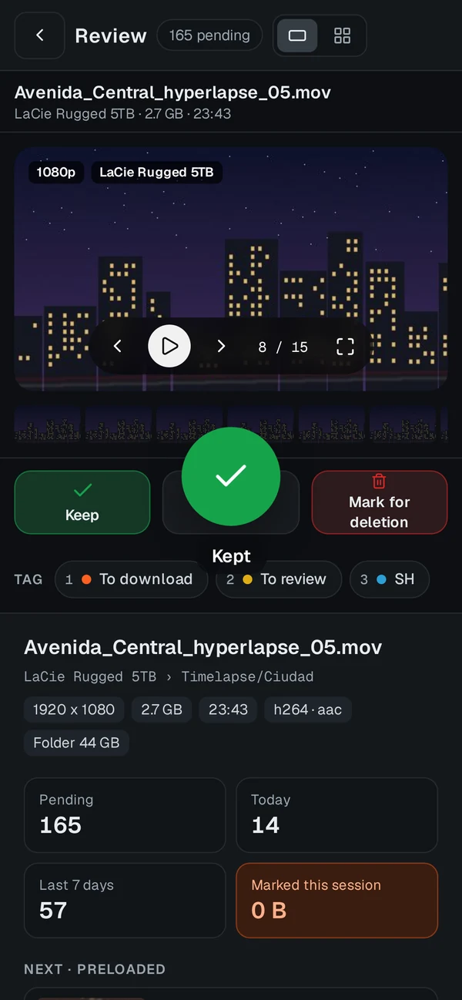
  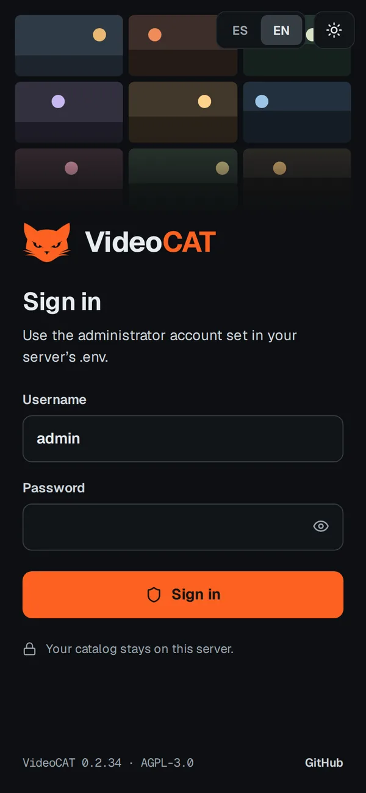
</p>

All screenshots use fictional data.
</details>

## Quick start

### 1. Server with Docker

You need Docker with Compose. The installer creates a `videocat` folder, downloads `docker-compose.hub.yml`, generates secrets in `.env` and starts the stack with the official images.

Linux, macOS or WSL:

```bash
curl -fsSL https://raw.githubusercontent.com/reiterstahl/videocat/main/install.sh | sh
```

Windows PowerShell with Docker Desktop:

```powershell
powershell -ExecutionPolicy Bypass -Command "irm https://raw.githubusercontent.com/reiterstahl/videocat/main/install.ps1 | iex"
```

Open `http://localhost:8081` and sign in as `admin` with the password the installer prints (it is also stored in `videocat/.env`).

<details>
<summary>Manual installation with the Docker Hub images</summary>

```bash
mkdir videocat && cd videocat
curl -fsSLO https://raw.githubusercontent.com/reiterstahl/videocat/main/docker-compose.hub.yml
curl -fsSL https://raw.githubusercontent.com/reiterstahl/videocat/main/.env.example -o .env
```

Edit `.env` and replace every `replace-with-…` value. Generate each secret with `openssl rand -hex 32`. For local testing without HTTPS, use `WEB_ORIGIN=http://localhost:8081` and `COOKIE_SECURE=false`. Then:

```bash
docker compose -f docker-compose.hub.yml up -d
```

Official images (amd64 and arm64): `reiterstahl/videocat-server` and `reiterstahl/videocat-web`, tagged by version (`0.2.50`) and `latest`.
</details>

### 2. Windows Companion

1. Install FFmpeg, which the Companion uses to read metadata and create thumbnails. It is found automatically when installed with WinGet, Scoop or Chocolatey, or in `C:\ffmpeg\bin`:

   ```powershell
   winget install Gyan.FFmpeg
   ```

2. Download and run [**VideoCAT-Companion-win-Setup.exe**](https://github.com/reiterstahl/videocat/releases/latest/download/VideoCAT-Companion-win-Setup.exe), then open it from the Start menu. It lives in the system tray.
3. In the web app, open **Administration › Companions** and generate a pairing code.
4. In the Companion, open **Settings… › Connection**, enter the server URL, paste the code and select **Pair**.
5. In **Settings… › Browser**, copy the local token and paste it in the web app under **Profile › Local Companion**. That browser can then open, copy and delete files on this PC.

> [!TIP]
> If you used the portable `.exe` (0.2.2 or earlier), close it, install with Setup.exe and delete the portable file: settings and pairing are kept in `%APPDATA%\VideoCAT Companion`.

The Companion follows Windows' display language (Spanish or English); **Settings… › Advanced › Language** can choose one.

### 3. Your drives

From the Companion's **Settings… › Paths** you can:

- **Add drive…** and **Convert…** on a drive without a marker: the Companion writes its `.videocat-disk.json` with the name you choose and from then on recognizes it under any letter.
- **Add folder…** for a local or network folder.
- See the **detected VideoCAT drives**: those with a `.videocat-disk.json` file at their root. The marker gives them a stable identity even if the drive letter changes, and lets you choose which inner folders to scan.

> [!IMPORTANT]
> Drives added by letter in Companions before 0.2.21 show **follows the letter**: Windows can give that letter to another drive, and its files would land in the wrong catalog. Use **Pin identity…**: the Companion compares a random sample of that catalog with the files on the drive you pick and, if it is the same drive, writes the marker keeping its catalog. If the sample shows another drive, or a catalog mixed with another drive, it tells you and offers to create a new disk instead.

You can also create the marker with the [CLI agent](#cli-agent) (`init-disk` or `wizard`) or by hand at the drive root:

```json
{
  "schemaVersion": 1,
  "diskId": "generate-a-uuid-v4",
  "diskName": "WD 6TB Video 01",
  "createdAt": "2026-10-02T00:00:00.000Z",
  "scanRoots": ["."]
}
```

The first scan uploads metadata and thumbnails. Later scans only process new or changed files.

### 4. Install as an app (optional)

VideoCAT can be installed from the browser. **Profile › VideoCAT app** shows the button or the steps for your browser:

- **Chrome and Edge** (Windows, macOS, Linux, Android): the **Install app** button in the sidebar, or the install icon in the address bar.
- **Firefox 143 or later on Windows**: the **Add to taskbar** icon to the right of the address bar. On Android: menu › **Install**.
- **iPhone and iPad**: **Share › Add to Home Screen**.
- **Safari on macOS**: **File › Add to Dock**.

> [!NOTE]
> Browsers only install apps over **HTTPS** (or from `localhost`). If you open VideoCAT over `http://` with a LAN IP, publish it with HTTPS behind your reverse proxy first.

The app only stores its own code (interface, styles and icons) on the device so it opens quickly. API responses, thumbnails and videos always come from the server, so no catalog data is left on the device. When you publish a new stack version, the app shows **A new version of VideoCAT is available · Update**.

### 5. S3 buckets (optional)

1. Check that `.env` has `STORAGE_SECRET_KEY` (64 hexadecimal characters). The installers generate it from 0.2.47; on older installations add one made with `openssl rand -hex 32`, and keep it with your backups.
2. Start the scanner: `docker compose -f docker-compose.hub.yml --profile s3 up -d`. In Portainer, add the variable `COMPOSE_PROFILES=s3` to the stack and redeploy it.
3. In **Administration › S3 storage**, add the bucket and test the connection. The first scan starts within seconds.

Tested against MinIO, Garage and RustFS. With Garage, the region is the `s3_region` of its configuration (`garage` by default), not `us-east-1`; with an IP address or `localhost` as the endpoint, keep path-style addressing on.

> [!TIP]
> Give VideoCAT an access key just for that bucket or prefix: list and read, plus delete only if you want to delete from Review. See [Security and privacy](#security-and-privacy).

### 6. Drive health (optional)

In the Companion, **Settings… › Paths › Drive health › Turn on…** and accept Windows' administrator prompt, once. A minute later **Administration › Drives** shows the health of every connected drive. Your Windows account must be one that can become an administrator; see [Failing drives](#failing-drives).

## Everyday use

### Review and safe deletion

1. Open **Review** and select **Start Review**. With **Show connected**, only videos from plugged-in drives appear.
2. Decide with the buttons or the keyboard. You can assign categories while reviewing.
3. **Mark for deletion** deletes nothing on the server: the video goes to the *Marked for deletion* category.
4. When the right drive is connected and the Companion is running, it deletes the pending files. It first revalidates size, modification time and visual fingerprint, and resolves the canonical path so it never follows links or junctions.
5. The history records date, drive, path and size for every deletion or failure, and the freed-space counter updates.

If you would rather the Companion not delete on its own, set **Delete marked files** to *Only on request* in **Settings… › Advanced**.

| Key | Review action |
| --- | --- |
| `F` | Keep |
| `J` | Mark for deletion |
| `S` | Skip |
| `Z` | Undo the last decision |
| `1`–`9` | Toggle a tag |
| `←` `→` | Previous or next frame |
| `Enter` | Play the frames |
| `Space` | Privacy mode: black screen until another `Space`, `Esc` or a click, without taking decisions |
| `G` | Switch between frame and gallery |
| `P` | Full screen |
| `Esc` | Exit |

In **Duplicates › Start assisted mode**: `1` or `←` keeps copy A and marks B for deletion, `2` or `→` does the opposite, `Enter` applies the recommendation, `S` skips the group and `Esc` exits.

### Safe transfers

1. In the Companion, set **Settings… › Files › Transfer staging folder**, for example `D:\VideoCAT\Transfers`. Without it, transfers wait.
2. **Consolidate**: in **Folder usage › Repeated folders**, star ⭐ the location that should receive the files (the interface warns if another one is larger) and press **Consolidate on…**. **Group**: in **Transfers › Group files** (or with the search icon in the catalog folder tree), choose the folder and decide file by file.
3. Connect the source drive: the Companion copies each file to the staging folder and removes it from the source **only after** verifying the copy.
4. Connect the destination drive: the Companion copies from staging, verifies, updates the catalog and **only then** removes the staging copy.

Guarantees at every step:
- The copy is written under a temporary name, hashed with SHA-256 while copying, flushed to disk, renamed and **read back in full** to compare. If it does not match, it is discarded and the original stays untouched.
- Before removing from the source, it checks it is still the file from the last scan (size and modification time); if it changed, it is left alone.
- Every step is recorded on the server before moving on, so a power cut or a drive unplugged halfway resumes from the last confirmed step.
- Nothing is overwritten: an identical file at the destination leaves the original for review in Duplicates; a different one is saved as `name (2).ext`.
- **Files leave their drives first.** With several drives connected, the Companion first moves into the staging folder everything that fits and only then delivers, so a drive that is both a source and a destination frees room before receiving files. When the staging folder is full, deliveries go first to make room.
- The staging drive always keeps **5 %** free. A full destination **does not prevent creating a transfer**: the files leave their drive and wait in the staging folder. The web warns *Space will run short on…* from the last scan, the Companion measures again when the destination is connected and delivers once there is room.
- While travelling, videos stay in the catalog marked **In transit**. Cancelling only stops what has not left its drive yet: whatever is already in staging finishes its way.

| Key | Action in Group files |
| --- | --- |
| `F` | Group into the folder |
| `J` | Ignore (not proposed again for that folder) |
| `S` | Skip |
| `Z` | Undo (a grouped file leaves the transfer while it is still pending) |

### Failing drives

Old external drives fail little by little, and the first sign is usually a file that takes forever to read. VideoCAT watches for that in two ways:

**Files with a read problem.** When a read gets no answer in 30 seconds, or the drive reports an I/O error, the Companion leaves that file at once (no retries, which would only stress the drive more), goes on with the next one and marks it **At risk**: later scans leave it alone for 30 days. A deletion that cannot read the file to confirm it is the catalogued one does not delete it and says so; a transfer whose drive stops sending data gives up on that file.

1. **Catalog › Filters › With read problems**, or **Show files** on the drive's notice in **Administration › Drives**, lists them.
2. Copy what you can to another drive with Windows or a recovery tool, or check the drive with its maker's tool. If you no longer need a file, delete it by hand.
3. **Read it again** on a file, or **Read them again** for the whole drive, takes them off the Companion's list: the next scan of that drive reads them in full. If they still fail, they go back to the list.

**Drive health (SMART).** With [drive health](#6-drive-health-optional) on, each drive in Administration says:

| State | When |
| --- | --- |
| **Good** | SMART reports nothing worrying. |
| **Attention** | Reallocated or pending sectors, spin-up retries, transfer errors (usually the cable or USB adapter), 55 °C or more, or, on NVMe, media errors or 90 % wear. |
| **Probable failure** | SMART says FAILED, uncorrectable sectors or read errors, an NVMe critical warning or spare blocks below the minimum, or damaged sectors that grew since the previous check. Copy what is not anywhere else. |
| **No SMART data** | The drive's USB adapter does not let SMART through. Files with read problems still raise their notice. |

A probable failure also shows a notice on every section. **Dismiss** hides it until the drive gets worse.

### Remote playback and Chromecast

The player first checks whether the browser supports the container and codecs. For H.264 videos with AAC or MP3 audio in an unsupported container, you can enable a **temporary MP4 remux**, which copies the streams without re-encoding:

1. On the server, set `REMOTE_REMUX_ENABLED=true` and restart `server`.
2. In the Companion, turn on **Temporary MP4 remux** in **Settings… › Advanced**.

VideoCAT does not transcode H.265, AV1 or other codecs, because that would use a lot of CPU. Each session belongs to the user who created it, has duration, idle and concurrency limits, and closes when the player stops or the tunnel drops.

**Read-ahead.** While a video plays, the server asks the Companion for several chunks at once and keeps the amount chosen in **Profile › Playback** ahead (8 to 128 MB, 32 MB by default), so a 4K video does not keep *loading*. It uses that much server memory per playback. If you open VideoCAT through a public domain (for example behind Cloudflare Tunnel), the video leaves and comes back through your internet connection even on the same network: that connection's upload speed is the ceiling.

Chromecast is off by default: enable it in **Profile**. The Google Cast SDK only loads when you use the button, and the receiver gets a signed, short-lived URL, never your credentials. The Chromecast must be able to reach VideoCAT's domain or IP.

## Production deployment

### Server variables

The main `.env` settings (the full, commented list is in [`.env.example`](.env.example)):

| Variable | Purpose |
| --- | --- |
| `POSTGRES_PASSWORD`, `JWT_SECRET`, `AGENT_TOKEN` | Secrets. Generate each one with `openssl rand -hex 32`. |
| `ADMIN_USER`, `ADMIN_PASSWORD` | Web app user. |
| `WEB_ORIGIN` | Exact public URL (for example `https://cat.example.com`). Writes from any other origin are rejected. |
| `COOKIE_SECURE` | `true` with HTTPS; `false` only for local testing. |
| `TRUST_PROXY`, `TRUST_PROXY_CIDRS` | Trust in the reverse proxy; preferably limited to its CIDRs. |
| `WEB_BIND_ADDR`, `WEB_PUBLISHED_PORT` | Where the `web` container is published (default `0.0.0.0:8081`). |
| `PROTECTED_FOLDER_PIN`, `PROTECTED_FOLDER_PATTERNS` | PIN and folder-name fragments to protect (for example `Private,Protected`). |
| `VIDEOCAT_VERSION` | Image version used by `docker-compose.hub.yml` (`0.2.50` or `latest`). |
| `REMOTE_REMUX_ENABLED`, `REMOTE_STREAM_*` | Optional remux and remote playback limits. |
| `STORAGE_SECRET_KEY` | Encrypts the secret keys of S3 buckets (64 hexadecimal characters). If it changes, each bucket's secret key has to be entered again. |
| `S3_SCAN_INTERVAL_HOURS`, `S3_SCAN_CONCURRENCY` | How often the scanner rereads each bucket (24) and how many videos it reads at a time (2). |
| `*_RETENTION_DAYS` | Retention for errors, actions and scans when cleanup runs from Administration. |

### Reverse proxy

Expose only the `web` container: it already proxies `/api/*` and `/thumbnails/*` to `server:4000` and forwards the tunnel WebSocket. Your external proxy must also allow `Upgrade` on `/api/agent/tunnel`. Nginx example:

```nginx
map $http_upgrade $connection_upgrade {
  default upgrade;
  ''      close;
}

server {
  server_name cat.example.com;
  client_max_body_size 25m;

  location / {
    proxy_pass http://127.0.0.1:8081;
    proxy_http_version 1.1;
    proxy_set_header Host $host;
    proxy_set_header X-Real-IP $remote_addr;
    proxy_set_header X-Forwarded-For $proxy_add_x_forwarded_for;
    proxy_set_header X-Forwarded-Host $host;
    proxy_set_header X-Forwarded-Proto $scheme;
    proxy_set_header Upgrade $http_upgrade;
    proxy_set_header Connection $connection_upgrade;
  }
}
```

With HTTPS, use `WEB_ORIGIN=https://cat.example.com`, `COOKIE_SECURE=true` and `TRUST_PROXY=true`. HTTPS is also required to install VideoCAT as an app.

### Updating

- **Server:** set `VIDEOCAT_VERSION` (or use `latest`) and run `docker compose -f docker-compose.hub.yml pull && docker compose -f docker-compose.hub.yml up -d`. Migrations run on start, and the `thumbnails-init` service fixes the thumbnail volume's permissions. In Portainer: *Pull and redeploy*.
- **Scanner** (only with S3 buckets): it comes with the same `pull` when the `s3` profile is on (`--profile s3`, or `COMPOSE_PROFILES=s3` in Portainer).
- **Companion:** updates itself. It checks for new versions a minute after starting and then every 6 hours, downloads them in the background and applies them on restart. You can also apply them with **Reiniciar para actualizar** (restart to update) in the tray or force a check with **Buscar actualizaciones** (check for updates).
- The web app shows a notice next to the logo when Docker Hub has a newer stack version.

Release notes for each version are in [OPERATIONS.md](OPERATIONS.md#upgrade).

### Behind Cloudflare Access or another sign-in proxy

VideoCAT works behind an access gateway such as Cloudflare Access. When that gateway's session expires, the app shows **Your access session expired** with a button to sign in again and come back to the same page. Point the Companion at the server's internal address (for example `http://192.168.1.30:8080`) or give it a service token, so it does not depend on that sign-in.

### Backups

`scripts/backup.sh` (or `scripts/backup.ps1`) saves the database, the thumbnail volume, checksums and `.env`. `scripts/verify-backup.sh` checks a backup and `scripts/restore.sh` restores it. Keep backups encrypted: they contain private paths and metadata. Details and a restore drill are in [OPERATIONS.md](OPERATIONS.md).

## Security and privacy

**Your data**
- Original videos never leave your drives. Only metadata, relative paths, validated JPEG thumbnails and audit errors are uploaded.
- The server needs no access to your drives. Physical deletion only happens on Windows, by the Companion, with the right drive connected.
- **The exception: S3 buckets.** To scan, play, download and delete their videos, the server and its scanner hold a key to the bucket (stored encrypted) and read its contents. Frames are taken into temporary files that are deleted right away; besides thumbnails, nothing of the videos stays on the server. Whoever took over the server could use that key, so give it one limited to that bucket or prefix, with delete permission only if you need it.
- Folders whose name matches `PROTECTED_FOLDER_PATTERNS` require a PIN in each session and are left out of duplicate detection.

**Companion**

- The tray (Electron) and the agent (its own executable, Node SEA) both run on a Node.js with the latest security fixes: packaging checks both and refuses an older one. Companion 0.2.23 and earlier left the tray on an unpatched Node (24.22.0) while Electron had no release with the October 2026 fixes, and 0.2.20 and earlier ran everything on one (24.19.0): installed Companions update on their own when restarted.
- Each installation uses an individual credential, paired with a one-time code, encrypted with the Windows user's protection and revocable from Administration. The server only stores its hash.
- The tunnel is outbound and authenticated, and only serves reads through HTTP Range: it accepts no remote writes.
- The local listener only answers `/health` without authentication. Opening, copying, deleting and processing queues require `COMPANION_TOKEN`.
- Paths are resolved canonically before opening, copying or deleting, and neither downloads nor transfers overwrite an existing file.
- In transfers, a file is only removed from one place after its copy in the next one is verified with SHA-256; every state change is applied atomically on the server, so a cancel or two Companions at once cannot overwrite each other.
- Updates come from GitHub Releases with a SHA-256 checksum, a provenance attestation and an SBOM.
- The Companion never runs as administrator. Drive health, when turned on, asks Windows for that permission once: smartctl (pinned by SHA-256) and its script are copied to `Program Files\VideoCAT SMART`, where only administrators can write, and a scheduled task runs them with fixed arguments; its results folder in ProgramData can only be read by users. Turning it off removes both.

**Web and API**
- Sign-in uses fixed-algorithm JWTs that expire after 12 hours, and writes are validated against `WEB_ORIGIN`.
- Body and time limits, rate limiting, no-cache sensitive responses, and CSP and HSTS (under HTTPS) from Nginx and Fastify.
- Non-root containers with a read-only file system and no capabilities.

**Project**
- On every change to `main` and every pull request, CI runs a clean install, a dependency audit, type checks, unit and API tests against PostgreSQL, coverage thresholds, the build and Playwright UI tests on desktop and mobile.
- Dependabot checks npm dependencies, base images and GitHub Actions every week.

To report a vulnerability privately, see [SECURITY.md](SECURITY.md).

## Companion configuration

Everything is edited from **Settings…**, organized in pages: Connection, Browser, Paths, Files, Advanced and Updates. It is stored in `%APPDATA%\VideoCAT Companion\.env`. **Drive health**, on the Paths page, is turned on and off with its own button because it needs Windows' administrator permission.

<details>
<summary>Companion variables</summary>

| Variable | Default | Use |
| --- | --- | --- |
| `SERVER_URL` | — | VideoCAT server URL (required). |
| `WEB_URL` | `SERVER_URL` | URL opened by **Open VideoCAT**. |
| `COMPANION_NAME` | — | Optional name shown in Administration. |
| `COMPANION_TOKEN` | Generated | Token for local actions; paste it in Profile › Local Companion. |
| `AGENT_TOKEN` | — | Shared token, only for legacy unpaired clients. |
| `COMPANION_DOWNLOAD_DIR` | — | Destination folder for **To download**. |
| `FFMPEG_PATH`, `FFPROBE_PATH` | Auto-detected | FFmpeg paths when they are not found automatically. |
| `AGENT_STATE_DIR` | `%LOCALAPPDATA%\VideoCAT\agent-state` | Local scan state. |
| `COMPANION_PORT` | `29429` | Local port (`127.0.0.1` only). |
| `COMPANION_ALLOWED_ORIGINS` | — | Web origins allowed to call the local listener. |
| `COMPANION_AUTO_DELETE_MARKED` | `true` | Delete marked files automatically or only on request. |
| `COMPANION_REMOTE_REMUX_ENABLED` | `false` | Temporary MP4 remux for remote playback. |
| `COMPANION_DISK_POLL_MS` | `5000` | Drive detection. |
| `COMPANION_SCAN_POLL_MS` | `900000` | Rescan of monitored paths. |
| `COMPANION_HEARTBEAT_MS` | `15000` | Heartbeat to the server. |
| `COMPANION_DELETE_POLL_MS` | `60000` | Check for pending deletions. |
| `COMPANION_DOWNLOAD_POLL_MS` | `60000` | Check of the download queue. |
| `COMPANION_DOWNLOAD_STALL_MS` | `30000` | Time before a copy counts as stalled. |
| `COMPANION_FILE_TIMEOUT_SECONDS` | `180` | Longest a scan spends on one file before leaving it at risk (30–3600). Each single read already gives up after 30 s. |
| `COMPANION_STAGING_DIR` | — | **Transfers** staging folder; empty disables transfers. Always keeps 5 % of its drive free. |
| `COMPANION_TRANSFER_POLL_MS` | `60000` | How often pending transfers are checked (minimum 15000). |
| `TRAY_DISK_POLL_MS` | `10000` | Drive refresh in the tray menu. |
| `COMPANION_LANGUAGE` | `auto` | Interface language: `auto` (Windows' display language), `es` or `en`. The activity log keeps the agent's lines as written. |
| `TRAY_CLICK_ACTION` | `open` | What a click or double click on the icon does: `open` (open VideoCAT), `activity` (show activity) or `settings` (open settings). |
</details>

### CLI agent

The same agent runs from the command line inside the repository (Node.js 22 or later, 24 LTS recommended, with FFmpeg on `PATH`). It reads the same settings from `apps\agent-windows\.env`.

```powershell
npm install
npm run wizard -w @videocat/agent-windows                       # interactive assistant
npm run init-disk -w @videocat/agent-windows -- --path "E:" --disk-name "WD 6TB Video 01" --scan-root "Videos"
npm run add-root -w @videocat/agent-windows -- --path "E:" --scan-root "Archive/Clients"
npm run scan -w @videocat/agent-windows -- --path "E:" --disk-name "WD 6TB Video 01"
npm run discover -w @videocat/agent-windows                     # lists marked drives
```

## Development

TypeScript monorepo with npm workspaces (Node.js 22 or later):

| Folder | Contents |
| --- | --- |
| `apps/server` | Fastify API + Prisma + PostgreSQL, and the S3 scanner (`src/scanner.ts`). |
| `apps/web` | React 18 + Vite app, served by Nginx in production. |
| `apps/agent-windows` | Scan agent and Electron Companion, with the Velopack updater. |
| `packages/shared` | Shared types and helpers. |
| `tests`, `e2e` | Unit and API tests (`node:test`) and UI tests (Playwright). |
| `scripts` | Backup, verification and restore. |

```bash
npm install
npm run prisma:generate
npm run dev:server   # API on http://localhost:4000 (needs DATABASE_URL and the other variables)
npm run dev:web      # Web app on http://localhost:5173
```

To run the whole stack built from source: `docker compose up -d --build`.

Tests:

```bash
npm run typecheck
npm test                          # unit, API and coverage thresholds
npx playwright install chromium
E2E_SEED=1 npm run test:e2e       # desktop and mobile
```

API tests that write to PostgreSQL run with `RUN_DB_TESTS=true`. `E2E_SEED=1` loads the demo catalog and **replaces all database content**: use it only with a development database. To load only the demo: `VIDEOCAT_DEMO_SEED=1 npm run seed:demo -w @videocat/server` (it refuses to run with `NODE_ENV=production`).

## Publishing releases

**Companion:** bump `version` in `apps/agent-windows/package.json` and push to `main`. The [`release-companion.yml`](.github/workflows/release-companion.yml) workflow builds on Windows, packs with Velopack (Setup.exe, full package and deltas), creates the `vX.Y.Z` tag and publishes the release with notes, SHA-256, attestation and SBOM. A version that is already tagged is never published again. To start it by hand: `gh workflow run release-companion.yml -f publish=true`.

**Companion beta:** `gh workflow run release-companion.yml -f publish=true -f beta=1` publishes `X.Y.Z-beta.1` as a GitHub prerelease. Installed Companions do not update to it: install it with its Setup.exe, and it moves to the next stable release on its own. Packaging refuses an Electron or an agent whose Node.js lacks the latest security fixes.

Local build without publishing (with `dotnet tool install -g vpk --version 1.2.161` to produce Setup.exe):

```powershell
powershell -ExecutionPolicy Bypass -File .\package-companion.ps1
```

**Docker images** (amd64 and arm64; also update `VIDEOCAT_VERSION` in `docker-compose.hub.yml` and the installers):

```bash
docker buildx build --pull --no-cache-filter base --platform linux/amd64,linux/arm64 -f apps/server/Dockerfile -t reiterstahl/videocat-server:0.2.50 -t reiterstahl/videocat-server:latest --push .
docker buildx build --pull --no-cache-filter base --platform linux/amd64,linux/arm64 -f apps/server/Dockerfile --target scanner -t reiterstahl/videocat-scanner:0.2.50 -t reiterstahl/videocat-scanner:latest --push .
docker buildx build --pull --no-cache-filter runtime --platform linux/amd64,linux/arm64 -f apps/web/Dockerfile --build-arg VITE_VIDEOCAT_VERSION=0.2.50 -t reiterstahl/videocat-web:0.2.50 -t reiterstahl/videocat-web:latest --push .
```

Verifying the Companion installer:

```powershell
Get-FileHash .\VideoCAT-Companion-win-Setup.exe -Algorithm SHA256
gh attestation verify .\VideoCAT-Companion-win-Setup.exe -R reiterstahl/videocat
```

<details>
<summary>Main API endpoints</summary>

Companion (`Authorization: Bearer` with the paired credential):

- `POST /api/agent/register-disk`
- `POST /api/agent/scan/start`, `POST /api/agent/scan/finish`
- `POST /api/agent/files/batch`
- `POST /api/agent/thumbnails/upload`
- `POST /api/agent/errors/batch`
- `GET /api/agent/tunnel` (WebSocket)

Web (session):

- `POST /api/auth/login`, `POST /api/auth/logout`
- `GET /api/files`, `GET /api/files/:id`, `GET /api/facets`, `GET /api/disks`
- `GET /api/review/summary`, `GET /api/review/next`, `GET /api/review/recoverable-space`
- `GET /api/duplicates/by-size`, `GET /api/duplicates/recommended-disks`, `POST /api/duplicates/assisted/decision`
- `POST /api/stream-sessions`, `GET /api/stream-sessions/:id`, `DELETE /api/stream-sessions/:id`, `GET /api/playback/random`
- `POST /api/companions/pairing-code`, `GET /api/companions`
- `GET /api/folder-usage`, `GET /api/folder-usage/tree`
- `GET /api/audit/errors`, `GET /api/audit/actions`, `GET /api/audit/export`
- `GET /api/admin/disks/overview`, `GET /api/admin/maintenance`
- `GET /api/profile/security`, `PATCH /api/profile/security`
- `GET /api/version/latest`
</details>

## Related documentation

| Document | Contents |
| --- | --- |
| [OPERATIONS.md](OPERATIONS.md) | Upgrades, backups, restore and Portainer. |
| [SECURITY.md](SECURITY.md) | Security policy and private vulnerability reporting. |
| [apps/agent-windows/TRAY.md](apps/agent-windows/TRAY.md) | Tray Companion details (Spanish). |
| [ROADMAP.md](ROADMAP.md) | Hardening and reliability plan. |
| [REMOTE_STREAMING_PLAN.md](REMOTE_STREAMING_PLAN.md) | Design of secure remote playback. |
| [COMMUNITY_SCRIPTS_PLAN.es.md](COMMUNITY_SCRIPTS_PLAN.es.md) | Plan to publish VideoCAT on community-scripts (Proxmox VE), in Spanish. |
| [UI_REDESIGN_PLAN.md](UI_REDESIGN_PLAN.md) | Phased interface redesign. |
| [TRANSFERS_PLAN.es.md](TRANSFERS_PLAN.es.md) | Design and progress of Transfers (consolidate and group), in Spanish. |
| [PUBLISHING.md](PUBLISHING.md) | Checklist for publishing official artifacts. |

## License and support

VideoCAT is released under the [`AGPL-3.0-or-later`](LICENSE) license: you can use, study, modify and distribute the project and derived versions, following its copyleft and attribution obligations. The Windows Companion includes an unmodified `smartctl.exe` from [smartmontools](https://www.smartmontools.org) 7.5 (GPL-2.0-or-later), with its license and the link to its source next to it.

The official distribution includes optional links to support the original author ([GitHub Sponsors](https://github.com/sponsors/reiterstahl)). Forks and modified versions may remove or replace them, as long as they comply with the license and keep the required copyright and attribution notices.
